<div align="center">

# 🩺 MedScan-NCD
### **AI-Assisted Non-Communicable Disease Prediction & Smart Medicine Adherence Platform**

[](https://react.dev/)
[](https://vitejs.dev/)
[](https://tailwindcss.com/)
[](https://nodejs.org/)
[](https://expressjs.com/)
[](https://www.mongodb.com/atlas)
[](https://www.python.org/)
[](https://fastapi.tiangolo.com/)
[](https://lightgbm.readthedocs.io/)
[](https://www.espressif.com/)
[](LICENSE)

<br/>

<p align="justify">
<strong>MedScan-NCD</strong> is an enterprise-grade clinical decision support and medication tracking ecosystem that bridges the critical gap between diagnostic laboratory data, clinical risk stratification, and daily outpatient therapy adherence. By coupling <strong>dual-engine Optical Character Recognition (OCR)</strong>, <strong>calibrated machine learning pipelines (LightGBM & Framingham CHD)</strong>, <strong>TreeSHAP directional explainability</strong>, and <strong>ESP32 IoT smart dispenser telemetry</strong>, MedScan-NCD empowers patients, clinicians, and Community Health Officers (CHOs) with unified preventative intelligence.
</p>

<br/>


<br/><br/>

[🎥 Project Demo](#-project-demo) •
[📸 Screenshot Gallery](#-platform-visual-showcase) •
[🛠️ Image Replacement Guide](#-media--image-customization-guide-what-to-add-or-replace) •
[🏗️ Architecture](#️-system-architecture) •
[🚀 Key Workspaces](#-key-modules--role-workspaces) •
[🧠 ML Models](#-machine-learning-models--explainability) •
[🛡️ Security Lab](#️-security-reliability--resilience-lab) •
[💻 Local Setup](#-getting-started--local-installation)

</div>

---

## 📑 Table of Contents

- [🌟 System Overview & Problem Statement](#-system-overview--problem-statement)
- [🎥 Project Demo](#-project-demo)
- [📸 Platform Visual Showcase](#-platform-visual-showcase)
- [🛠️ Media & Image Customization Guide (What to Add or Replace)](#-media--image-customization-guide-what-to-add-or-replace)
- [🏗️ System Architecture & Data Flow](#️-system-architecture--data-flow)
- [🚀 Key Modules & Role Workspaces](#-key-modules--role-workspaces)
  - [1. Patient Health & Risk Workspace](#1-patient-health--risk-workspace)
  - [2. Clinician / Doctor Portal](#2-clinician--doctor-portal)
  - [3. Community Health Officer (CHO) Rural Screening Portal](#3-community-health-officer-cho-rural-screening-portal)
  - [4. Admin Portal & Security Demonstration Lab](#4-admin-portal--security-demonstration-lab)
  - [5. IoT Smart Medicine Reminder & Dispenser Telemetry](#5-iot-smart-medicine-reminder--dispenser-telemetry)
- [🔬 OCR & Document Understanding Pipeline](#-ocr--document-understanding-pipeline)
- [🧠 Machine Learning Models & Explainability](#-machine-learning-models--explainability)
  - [Clinical Model Benchmarking](#clinical-model-benchmarking)
  - [TreeSHAP Directional Attribution](#treeshap-directional-attribution)
  - [Model Evaluation Plots](#model-evaluation-plots)
- [🛡️ Security, Reliability & Resilience Lab](#️-security-reliability--resilience-lab)
  - [Concept 1: Database Blackout & Snapshot Restore Engine](#concept-1-database-blackout--snapshot-restore-engine)
  - [Concept 2: Medical Data Breach & AES-256-GCM Encryption](#concept-2-medical-data-breach--aes-256-gcm-encryption)
- [📡 ESP32 Smart Medicine Dispenser Telemetry](#-esp32-smart-medicine-dispenser-telemetry)
- [📊 Demonstration Accounts & Quick Logins](#-demonstration-accounts--quick-logins)
- [💻 Getting Started & Local Installation](#-getting-started--local-installation)
- [🔌 API Endpoints Reference](#-api-endpoints-reference)
- [📂 Project Directory Structure](#-project-directory-structure)
- [⚖️ Clinical Disclaimer & Ethical Notice](#️-clinical-disclaimer--ethical-notice)
- [👥 Authors & Acknowledgments](#-authors--acknowledgments)

---

## 🌟 System Overview & Problem Statement

<p align="justify">
Non-Communicable Diseases (NCDs)—primarily <strong>Type-2 Diabetes</strong>, <strong>Cardiovascular Diseases (CHD)</strong>, <strong>Hypertension</strong>, and <strong>Chronic Kidney Disease (CKD)</strong>—represent the single largest contributor to premature global mortality, accounting for over 74% of worldwide deaths according to the World Health Organization (WHO). In developing economies and rural healthcare ecosystems, early intervention is systematically undermined by four critical operational bottlenecks:
</p>

<p align="justify">
1. <strong>Fragmented Paper Records:</strong> Patients receive diagnostic test results on paper printouts that are easily misplaced, deteriorate over time, and fail to generate a longitudinal clinical profile.<br/>
2. <strong>Delayed Clinical Risk Stratification:</strong> Primary health facilities and rural outreach clinics lack on-site specialists to calculate complex cardiometabolic risk scores across disparate blood markers.<br/>
3. <strong>Opaque AI Predictions:</strong> Conventional automated risk assessment software operates as an unexplainable "black box," discouraging physician trust and confusing non-specialist health workers.<br/>
4. <strong>Medication Non-Adherence:</strong> Nearly 50% of chronic patients fail to adhere to their prescribed therapeutic regimens, resulting in preventable hospitalizations, organ damage, and avoidable complications.
</p>

<p align="justify">
<strong>MedScan-NCD addresses this continuum through an integrated five-pillar ecosystem:</strong>
</p>

<p align="justify">
• <strong>Automated Diagnostic Ingestion:</strong> Ingests scanned lab reports or digital PDFs via a dual-engine OCR pipeline (Tesseract.js and pdf-parse), extracting vital biomarkers into structured schemas.<br/>
• <strong>Human-in-the-Loop Governance:</strong> Validates extracted values against biological range safeguards and requires user confirmation before committing data to permanent longitudinal records.<br/>
• <strong>Calibrated Multi-Disease Risk Inference:</strong> Calculates calibrated statistical risk probabilities via isolated Python/FastAPI microservices running LightGBM (Platt-scaled) and Framingham 10-Year algorithms.<br/>
• <strong>Explainable Clinical AI (XAI):</strong> Exposes directional TreeSHAP feature contributions, explicitly showing which biomarkers drive a patient's risk higher or lower.<br/>
• <strong>IoT Smart Dispenser Hardware Telemetry:</strong> Integrates with an ESP32-powered physical pill organizer with real-time IR compartment sensors, auditing dose intake and alerting caregivers upon missed doses.
</p>

---

## 🎥 Project Demo

<p align="justify">
Experience the complete software workflow of <strong>MedScan-NCD</strong>—including user authentication, medical report upload, automatic OCR biomarker extraction, human verification, multi-disease risk computation, TreeSHAP explanation, prescription scheduling, and the admin resilience demonstration.
</p>

<div align="center">

<table width="100%" style="max-width: 900px; border: 1px solid #334155; border-radius: 12px; overflow: hidden; background-color: #0f172a;">
  <tr>
    <td align="center" style="padding: 24px;">
      <a href="https://www.youtube.com/watch?v=wAEQTsz9OHU" target="_blank">
        
      </a>
      <br/><br/>
      <a href="https://www.youtube.com/watch?v=wAEQTsz9OHU" target="_blank">
        
      </a>
      <br/><br/>
      <p align="center">
        <sub><em>Click the poster or badge above to watch the full software demonstration on YouTube.</em></sub>
      </p>
    </td>
  </tr>
</table>

</div>

---

## 📸 Platform Visual Showcase

<p align="justify">
The following gallery presents the primary role portals, clinical dashboards, machine learning evaluations, and hardware telemetry interfaces of the MedScan-NCD platform:
</p>

<div align="center">

### 1. Patient Experience & Diagnostic Intelligence

<table width="100%">
  <tr>
    <th width="50%" align="center">Patient Vitals & Profile Hub</th>
    <th width="50%" align="center">Dual-Engine OCR Extraction & Review Modal</th>
  </tr>
  <tr>
    <td align="center" style="padding: 10px;">
      <a href="assets/screenshots/01-patient-dashboard.png" target="_blank">
        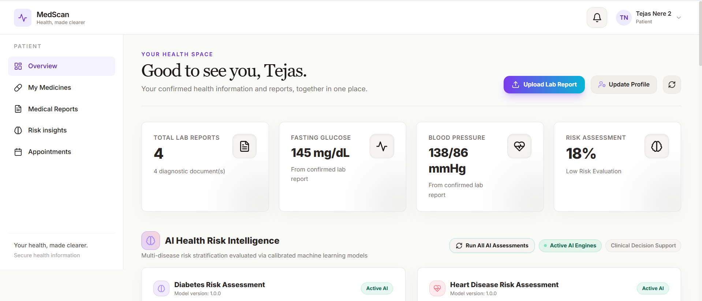
      </a>
      <br/>
      <sub><strong>Figure 1.1:</strong> Real-time patient overview showing longitudinal biomarker cards, care team, and profile vitals.</sub>
    </td>
    <td align="center" style="padding: 10px;">
      <a href="assets/screenshots/02-ocr-upload-review.png" target="_blank">
        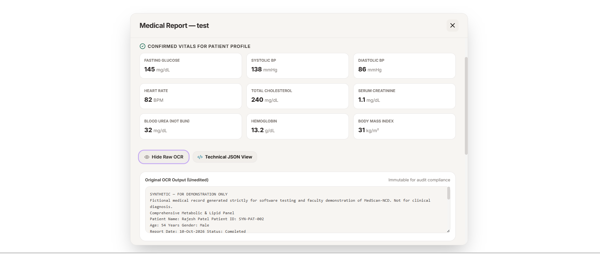
      </a>
      <br/>
      <sub><strong>Figure 1.2:</strong> Human-in-the-loop review modal with confidence scores and physiological range validation.</sub>
    </td>
  </tr>
  <tr>
    <th width="50%" align="center">Multi-Disease Risk Prediction Cards</th>
    <th width="50%" align="center">Medicine Scheduling & IoT Telemetry Sync</th>
  </tr>
  <tr>
    <td align="center" style="padding: 10px;">
      <a href="assets/screenshots/ai-disease-risk-cards.png" target="_blank">
        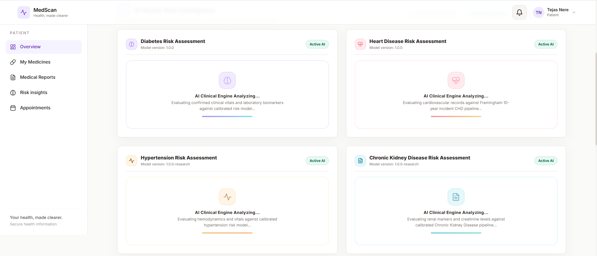
      </a>
      <br/>
      <sub><strong>Figure 1.3:</strong> Four-disease predictive risk assessment suite (Diabetes, Heart Disease, Hypertension, CKD).</sub>
    </td>
    <td align="center" style="padding: 10px;">
      <a href="assets/screenshots/04-medicine-reminder-schedule.png" target="_blank">
        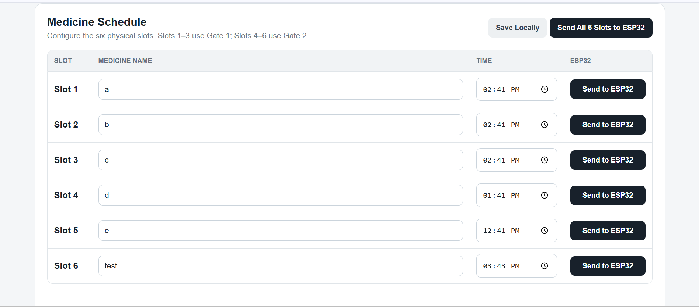
      </a>
      <br/>
      <sub><strong>Figure 1.4:</strong> Smart medicine scheduler with active prescriptions, dose logs, and hardware sync status.</sub>
    </td>
  </tr>
</table>

<br/>

### 2. Clinical Administration & Provider Portals

<table width="100%">
  <tr>
    <th width="50%" align="center">Doctor Clinical Portal & Trajectories</th>
    <th width="50%" align="center">CHO Rural Community Catchment Portal</th>
  </tr>
  <tr>
    <td align="center" style="padding: 10px;">
      <a href="assets/screenshots/05-doctor-clinical-portal.png" target="_blank">
        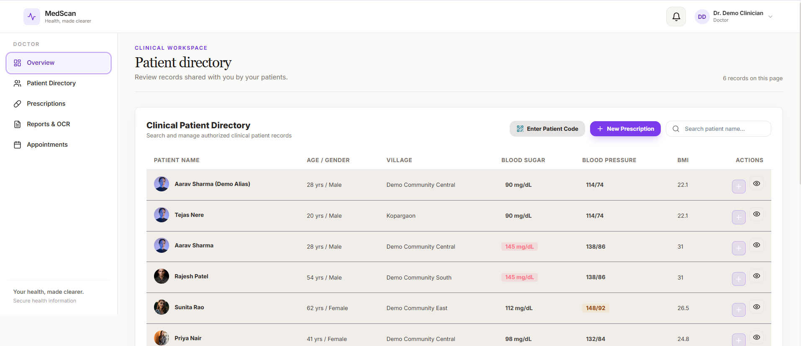
      </a>
      <br/>
      <sub><strong>Figure 2.1:</strong> Physician workspace featuring patient cohort filters, longitudinal trajectory charts, and e-prescriptions.</sub>
    </td>
    <td align="center" style="padding: 10px;">
      <a href="assets/screenshots/06-cho-community-catchment.png" target="_blank">
        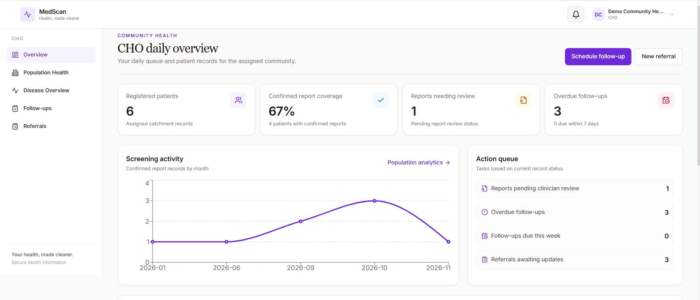
      </a>
      <br/>
      <sub><strong>Figure 2.2:</strong> Rural health worker dashboard with village-level screening metrics, high-risk triage, and referrals.</sub>
    </td>
  </tr>
  <tr>
    <th width="50%" align="center">Admin Security & Resilience Demonstration Lab</th>
    <th width="50%" align="center">ESP32 Smart Dispenser Hardware Telemetry</th>
  </tr>
  <tr>
    <td align="center" style="padding: 10px;">
      <a href="assets/screenshots/07-admin-security-resilience-lab.png" target="_blank">
        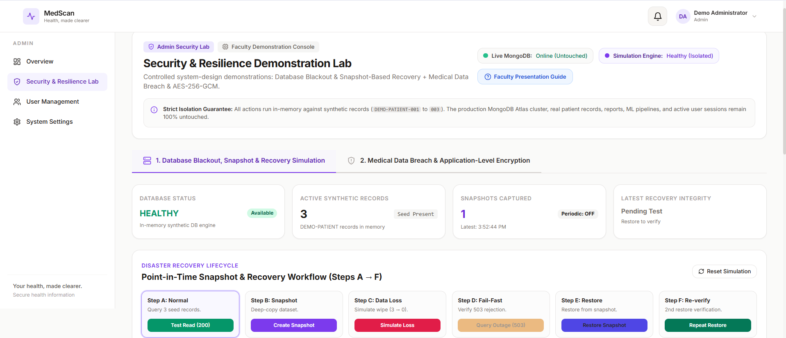
      </a>
      <br/>
      <sub><strong>Figure 2.3:</strong> Admin-only lab demonstrating database blackout, SHA-256 snapshot restore, and AES-256-GCM defense.</sub>
    </td>
    <td align="center" style="padding: 10px;">
      <a href="assets/screenshots/08-iot-smart-dispenser-hardware.jpeg" target="_blank">
        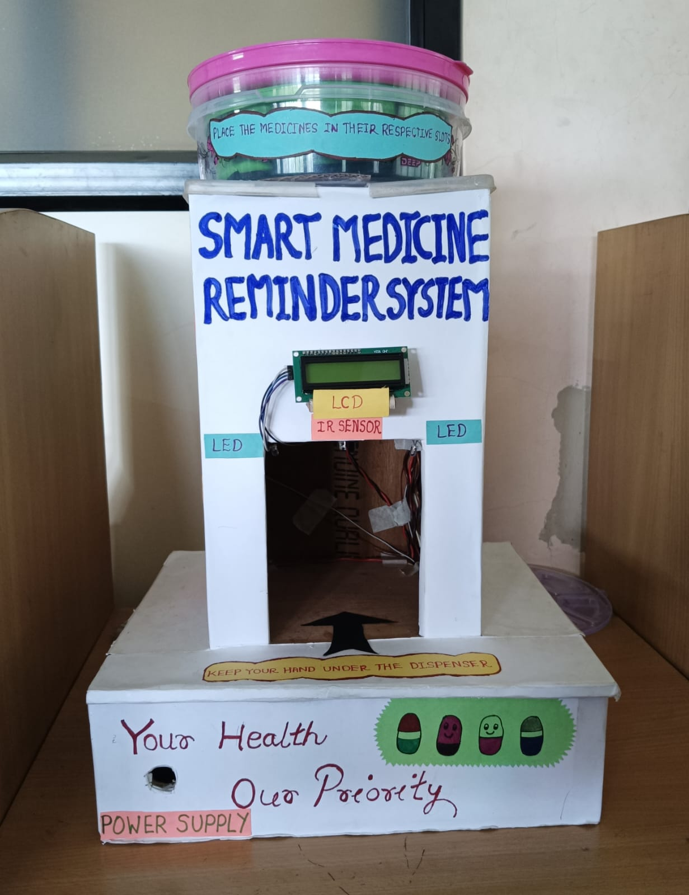
      </a>
      <br/>
      <sub><strong>Figure 2.4:</strong> ESP32 smart dispenser prototype with IR pill detection, RTC synchronization, and HTTP telemetry.</sub>
    </td>
  </tr>
</table>

</div>


## 🏗️ System Architecture & Data Flow

<p align="justify">
MedScan-NCD is structured as a resilient, multi-tiered decoupled microservices architecture designed to isolate intensive computer vision (OCR) and machine learning matrix calculations from core transaction routing:
</p>

<div align="center">
  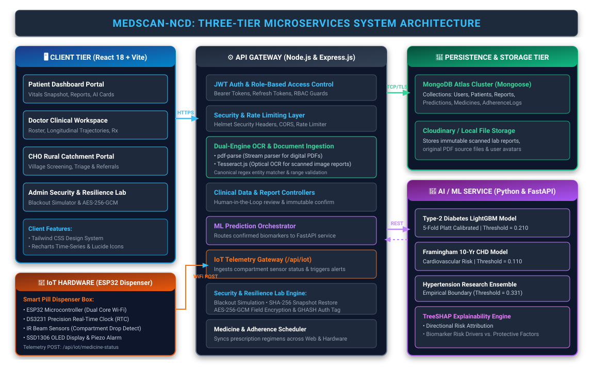
</div>

<br/>

<details>
<summary>🔍 <b>View System Architecture Mermaid Code</b></summary>

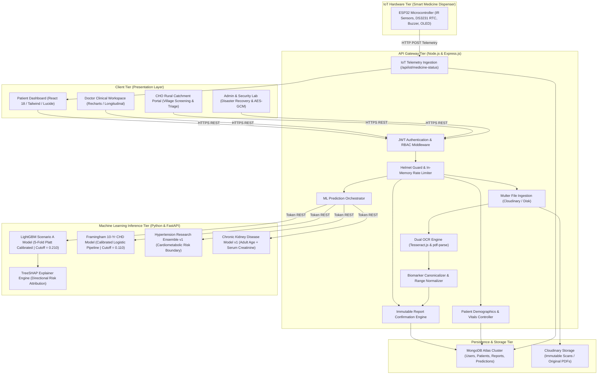

</details>

<br/>

### End-to-End User & Hardware Interaction Sequence

<div align="center">
  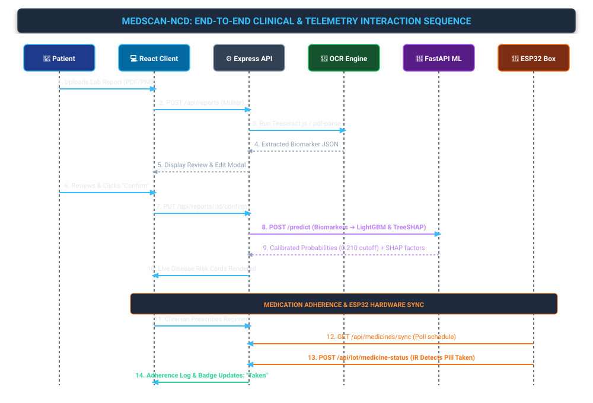
</div>

<br/>

<details>
<summary>🔍 <b>View Interaction Sequence Mermaid Code</b></summary>

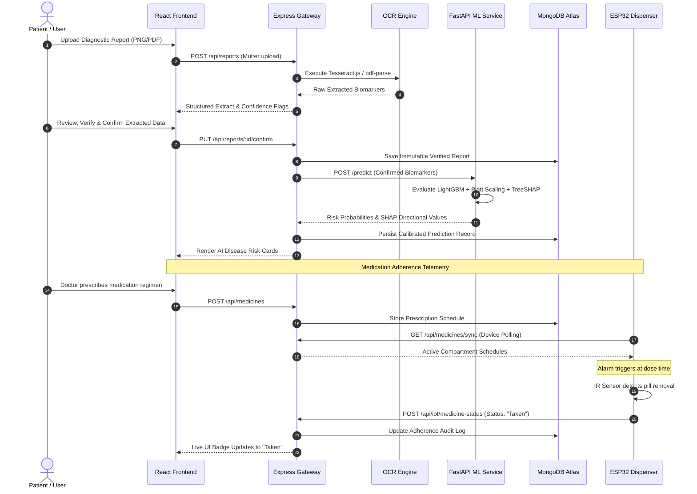

</details>

---

## 🚀 Key Modules & Role Workspaces

<p align="justify">
MedScan-NCD implements role-based access control (RBAC) across four authenticated user personas and a hardware telemetry interface:
</p>

### 1. Patient Health & Risk Workspace
<p align="justify">
• <strong>Longitudinal Biomarkers Snapshot:</strong> Displays vital statistics (Resting BP, Fasting Glucose, Total Cholesterol, HDL, Serum Creatinine, Blood Urea, Hemoglobin, and BMI) with color-coded status badges.<br/>
• <strong>Document Upload & OCR Review:</strong> Multi-format file uploader supporting PNG, JPG, and digital PDF formats. Automatically classifies documents into CBC, Lipid Panel, Renal Function, or Ambulatory Blood Pressure reports.<br/>
• <strong>Human-in-the-Loop Clinical Verification:</strong> Prior to persisting extracted data into clinical records, users review values in a high-contrast modal highlighting unconfirmed or out-of-range biomarkers.<br/>
• <strong>Live Multi-Disease Risk Engine:</strong> On-demand evaluation of Type-2 Diabetes, Coronary Heart Disease, Hypertension, and Chronic Kidney Disease with plain-English preventative guidance.<br/>
• <strong>Care Team Association:</strong> Directly connects patients with their assigned primary clinician and community health worker.
</p>

### 2. Clinician / Doctor Portal
<p align="justify">
• <strong>Patient Cohort Directory:</strong> Real-time searchable roster of assigned outpatients with instantaneous status badges (Normal, Borderline, Elevated Risk).<br/>
• <strong>Longitudinal Trajectory Analytics:</strong> Interactive Recharts time-series graphs displaying historical fluctuations in systolic/diastolic blood pressure, glucose curves, and renal clearance across multiple clinical encounters.<br/>
• <strong>Clinical Verification Audit:</strong> Review raw laboratory uploads alongside extracted OCR outputs and ML model confidence scores.<br/>
• <strong>E-Prescription & Regimen Management:</strong> Prescribe medications with granular dosage, frequency, specific schedule times, and clinical intake notes that automatically sync with the patient portal and hardware dispenser.
</p>

### 3. Community Health Officer (CHO) Rural Screening Portal
<p align="justify">
• <strong>Village Catchment Surveillance:</strong> Aggregated population health metrics across designated rural administrative units (e.g., Green Valley, Demo Central, South Village, East Village).<br/>
• <strong>Automated High-Risk Beneficiary Triage:</strong> Immediate identification of community members exceeding critical cardiometabolic risk thresholds.<br/>
• <strong>Community Follow-Up Scheduler:</strong> Track overdue, pending, and scheduled home health visits to ensure rural outreach compliance.<br/>
• <strong>Tertiary Hospital Referrals:</strong> Direct digital referral pipeline connecting grassroots health sub-centers to secondary and tertiary medical institutions.
</p>

### 4. Admin Portal & Security Demonstration Lab
<p align="justify">
• <strong>System Administration:</strong> Role assignments, user account activation, and platform-wide security audit trails.<br/>
• <strong>Disaster Recovery Simulation (Concept 1):</strong> In-memory database outage simulation returning sanitized HTTP 503 responses, active synthetic data loss, point-in-time snapshot recovery, and SHA-256 byte-level integrity verification.<br/>
• <strong>Cryptographic Defense Lab (Concept 2):</strong> Live comparison between raw plaintext database breaches and application-level AES-256-GCM ciphertext, demonstrating GHASH authentication tag rejection upon ciphertext tampering.
</p>

### 5. IoT Smart Medicine Reminder & Dispenser Telemetry
<p align="justify">
• <strong>Automated Schedule Synchronization:</strong> Prescription schedules authored by physicians automatically propagate to the physical ESP32 dispenser.<br/>
• <strong>Zero-Claim Adherence Verification:</strong> Utilizes physical infrared beam-break sensors to confirm actual pill compartment opening rather than relying on unverified user checkmarks.<br/>
• <strong>Automated Caregiver Escalation:</strong> When a scheduled medication time lapses without sensor detection, the telemetry service logs a <code>Missed</code> dose event and triggers notifications.
</p>

---

## 🔬 OCR & Document Understanding Pipeline

<p align="justify">
Medical diagnostic reports exhibit significant variation in typographic formatting, table structures, and naming conventions. MedScan-NCD employs a fault-tolerant dual-engine OCR pipeline designed to reliably parse both digital vectors and low-contrast optical scans:
</p>

<div align="center">
  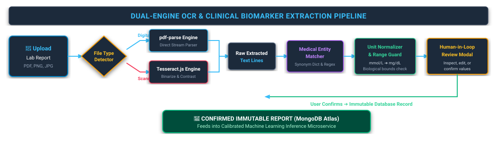
</div>

<br/>

<details>
<summary>🔍 <b>View OCR Pipeline Mermaid Code</b></summary>

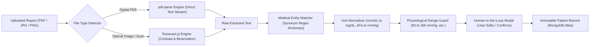

</details>

<br/>

<div align="center">

<table width="100%">
  <tr>
    <th width="45%" align="center">Scanned Diagnostic Laboratory Report</th>
    <th width="55%" align="center">Structured Normalized Biomarker Output</th>
  </tr>
  <tr>
    <td align="center" style="padding: 10px;">
      <a href="assets/screenshots/sample-lab-report-ocr.png" target="_blank">
        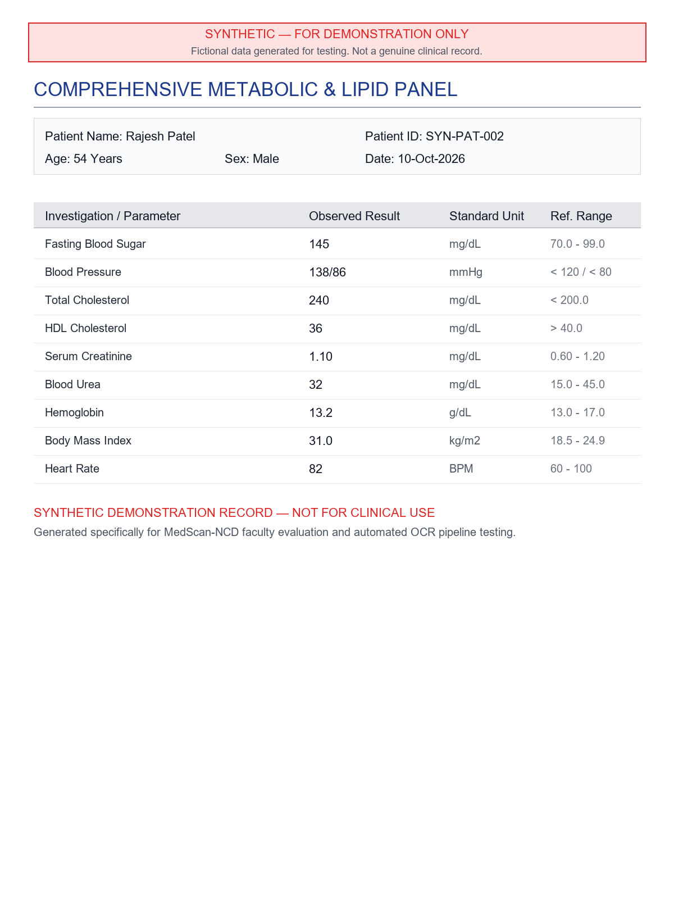
      </a>
      <br/>
      <sub><strong>Figure 3.1:</strong> Scanned clinical diagnostic report used for automated text extraction.</sub>
    </td>
    <td align="left" style="padding: 14px; background-color: #0f172a; border-radius: 8px; vertical-align: top;">

```json
{
  "reportType": "Lipid & Metabolic Panel",
  "extractedBiomarkers": {
    "bloodGlucose": {
      "value": 158.0,
      "unit": "mg/dL",
      "canonicalKey": "fasting_blood_glucose",
      "status": "elevated",
      "physiologicalValid": true
    },
    "bloodPressure": {
      "systolic": 142,
      "diastolic": 92,
      "unit": "mmHg",
      "status": "stage_1_hypertension",
      "physiologicalValid": true
    },
    "serumCreatinine": {
      "value": 1.15,
      "unit": "mg/dL",
      "canonicalKey": "serum_creatinine",
      "status": "normal",
      "physiologicalValid": true
    },
    "totalCholesterol": {
      "value": 224.0,
      "unit": "mg/dL",
      "canonicalKey": "total_cholesterol",
      "status": "borderline_high",
      "physiologicalValid": true
    }
  },
  "extractionConfidence": 0.942,
  "humanVerified": false
}
```

    </td>
  </tr>
</table>

</div>

---

## 🧠 Machine Learning Models & Explainability

### Clinical Model Benchmarking

<p align="justify">
Rather than relying on uncalibrated heuristic scores, MedScan-NCD employs machine learning pipelines trained on verified clinical epidemiological datasets. In medical screening applications, model calibration is paramount: an uncalibrated model may display 90% accuracy while dramatically distorting real-world probabilities. All models run in an isolated Python/FastAPI microservice:
</p>

| Disease Risk Condition | Core Algorithm | Training Cohort | Calibration Technique | Calibrated Decision Threshold | Primary Features Utilized |
| :--- | :--- | :--- | :--- | :---: | :--- |
| **Type-2 Diabetes** | **LightGBM** (Scenario A) | NHANES Cardiometabolic Cohort | 5-Fold Sigmoid (Platt) Scaling | **`0.210`** (Recall Optimized) | Age, Sex, BMI, Systolic BP, Diastolic BP, Total Cholesterol, HDL, Serum Creatinine |
| **Cardiovascular Disease** | **Framingham 10-Yr CHD** | Framingham Heart Study | Calibrated Logistic Pipeline | **`0.110`** (Clinical Cutoff) | Age, Biological Sex, Total Cholesterol, Systolic BP, Diastolic BP, BMI, Fasting Glucose, Smoking |
| **Hypertension** | **Research Ensemble v1** | Clinical Inpatient Risk Cohort | Isotonic Probability Mapping | **`0.331`** (Population Baseline) | Systolic BP, Diastolic BP, Age, BMI, Fasting Glucose, Heart Rate, Smoking Status |
| **Chronic Kidney Disease** | **Minimal UCI Model v1** | UCI Chronic Kidney Disease | Minimal Robust Boundary | **`0.967`** (High Specificity) | Adult Age ($>18$), Serum Creatinine ($>0.0\text{ mg/dL}$) |

<br/>

### TreeSHAP Directional Attribution

<p align="justify">
To satisfy the stringent transparency standards required in healthcare software, the LightGBM diabetes risk engine incorporates <strong>TreeSHAP (SHapley Additive exPlanations)</strong>. TreeSHAP computes the mathematically rigorous Shapley value for each clinical biomarker relative to the expected base value:
</p>

$$\mathbb{E}[f(x)] + \sum_{j=1}^{M} \phi_j(x) = f(x)$$

<p align="justify">
• <strong>Positive $\phi_j$ (Risk Drivers):</strong> Values that elevate patient risk (e.g., Fasting Glucose $= 158\text{ mg/dL}$, Systolic BP $= 142\text{ mmHg}$). Rendered in amber/red on the dashboard.<br/>
• <strong>Negative $\phi_j$ (Protective Factors):</strong> Biomarkers that mitigate disease probability (e.g., $\text{HDL} = 56\text{ mg/dL}$, $\text{BMI} = 22.4\text{ kg/m}^2$). Rendered in emerald green.
</p>

<br/>

### Model Evaluation Plots

<p align="justify">
The predictive performance, statistical calibration, and explainability of the primary LightGBM diabetes risk model were rigorously benchmarked:
</p>

<div align="center">

<table width="100%">
  <tr>
    <th width="50%" align="center">TreeSHAP Directional Feature Importance</th>
    <th width="50%" align="center">Platt Reliability Calibration Curve</th>
  </tr>
  <tr>
    <td align="center" style="padding: 10px;">
      <a href="assets/plots/shap_summary_beeswarm.png" target="_blank">
        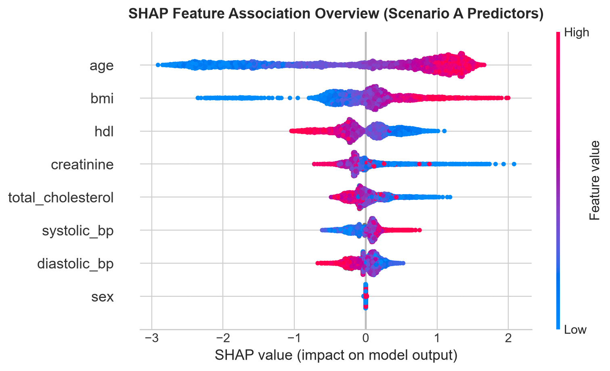
      </a>
      <br/>
      <sub><strong>Figure 4.1:</strong> TreeSHAP beeswarm distribution showing individual feature attributions across clinical cohort.</sub>
    </td>
    <td align="center" style="padding: 10px;">
      <a href="assets/plots/calibration_curve_comparison.png" target="_blank">
        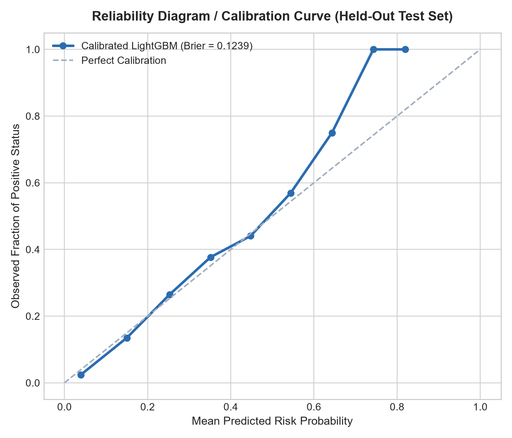
      </a>
      <br/>
      <sub><strong>Figure 4.2:</strong> 5-Fold Sigmoid Platt calibration aligning raw model outputs with empirical medical probabilities.</sub>
    </td>
  </tr>
  <tr>
    <th width="50%" align="center">ROC Curve Benchmark (AUC = 0.828)</th>
    <th width="50%" align="center">Precision-Recall Tradeoff Curve</th>
  </tr>
  <tr>
    <td align="center" style="padding: 10px;">
      <a href="assets/plots/roc_curve_comparison.png" target="_blank">
        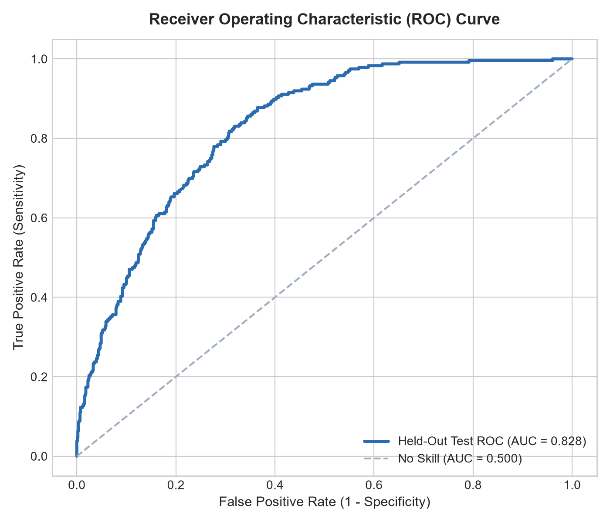
      </a>
      <br/>
      <sub><strong>Figure 4.3:</strong> Receiver Operating Characteristic curve demonstrating superiority over logistic and tree baselines.</sub>
    </td>
    <td align="center" style="padding: 10px;">
      <a href="assets/plots/pr_curve_comparison.png" target="_blank">
        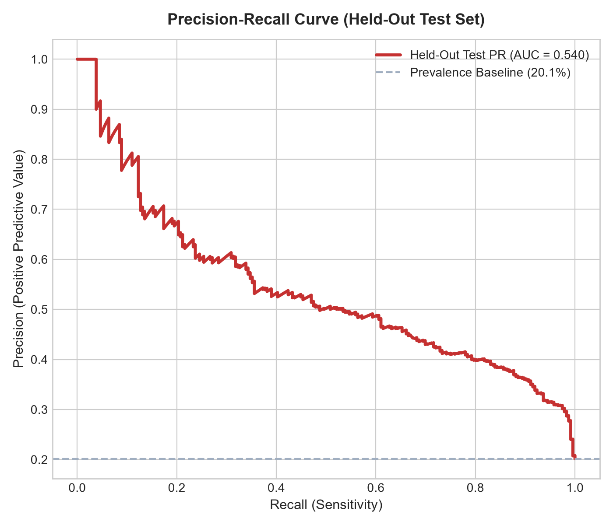
      </a>
      <br/>
      <sub><strong>Figure 4.4:</strong> Precision-Recall curve highlighting the optimal operating threshold (0.210) to minimize false negatives.</sub>
    </td>
  </tr>
  <tr>
    <th width="50%" align="center">Operating Threshold Trade-Off Analysis</th>
    <th width="50%" align="center">Held-Out Test Confusion Matrix</th>
  </tr>
  <tr>
    <td align="center" style="padding: 10px;">
      <a href="assets/plots/threshold_tradeoff_curve.png" target="_blank">
        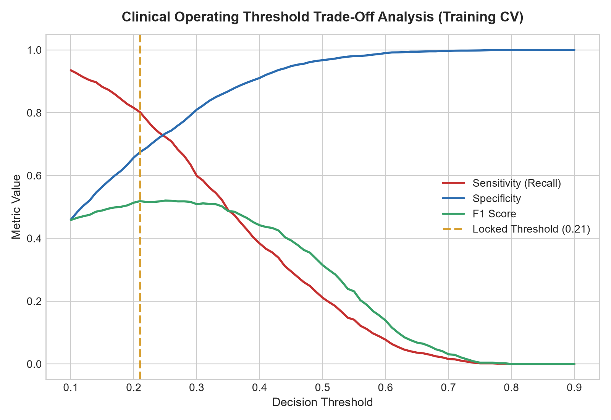
      </a>
      <br/>
      <sub><strong>Figure 4.5:</strong> Optimization curve demonstrating locked development cutoff (0.210) prioritizing high clinical sensitivity.</sub>
    </td>
    <td align="center" style="padding: 10px;">
      <a href="assets/plots/test_confusion_matrix.png" target="_blank">
        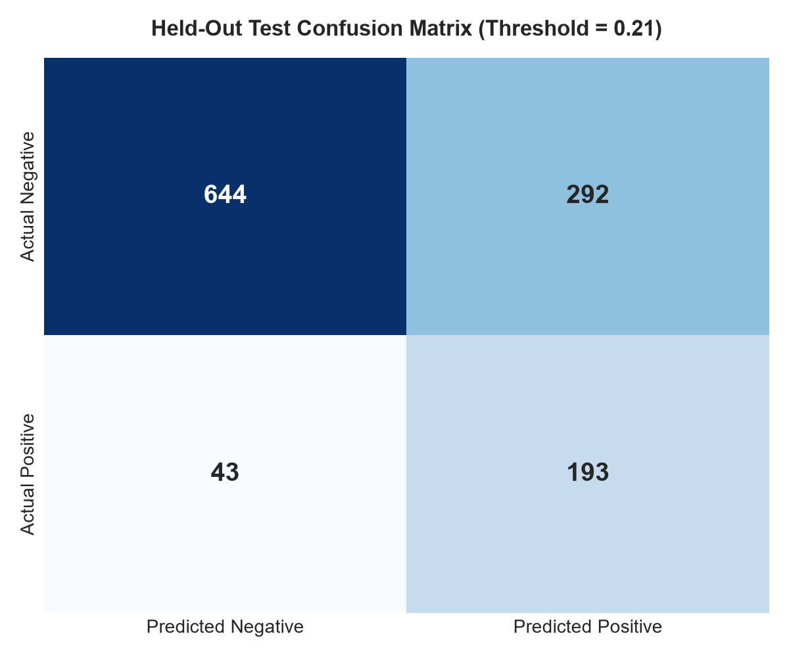
      </a>
      <br/>
      <sub><strong>Figure 4.6:</strong> 2×2 confusion matrix on 1,172 held-out samples yielding 81.8% sensitivity (193/236 cases identified).</sub>
    </td>
  </tr>
  <tr>
    <th width="50%" align="center">High-Risk Patient TreeSHAP Waterfall</th>
    <th width="50%" align="center">Protective Factors TreeSHAP Waterfall</th>
  </tr>
  <tr>
    <td align="center" style="padding: 10px;">
      <a href="assets/plots/shap_representative_waterfall_high_risk.png" target="_blank">
        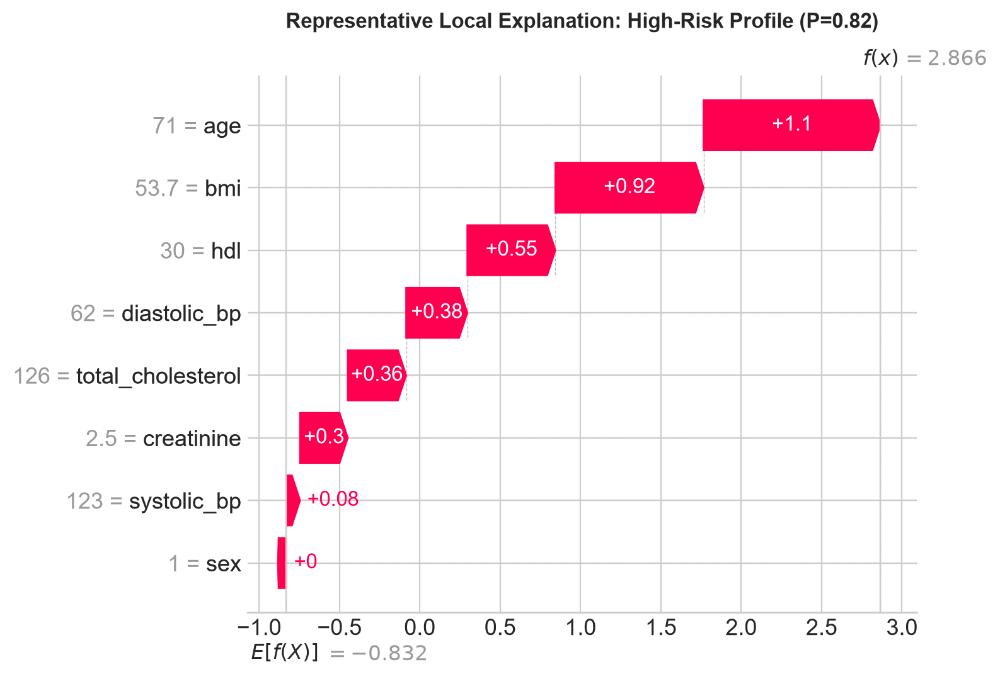
      </a>
      <br/>
      <sub><strong>Figure 4.7:</strong> Individual patient waterfall explanation highlighting elevated glucose and blood pressure driving high risk.</sub>
    </td>
    <td align="center" style="padding: 10px;">
      <a href="assets/plots/shap_representative_waterfall_low_risk.png" target="_blank">
        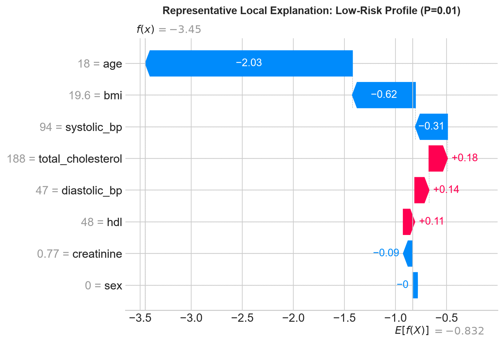
      </a>
      <br/>
      <sub><strong>Figure 4.8:</strong> Protective clinical waterfall explanation showing optimal HDL and youth lowering estimated risk.</sub>
    </td>
  </tr>
</table>

</div>

---

## 🛡️ Security, Reliability & Resilience Lab

<p align="justify">
Integrated at route <code>/admin/security-lab</code>, this administrative subsystem provides interactive, faculty-ready demonstrations of distributed systems resilience and cryptographic defense against data breaches:
</p>

### Concept 1: Database Blackout & Snapshot Restore Engine
<p align="justify">
• <strong>Simulated Database Outage:</strong> Injects a controlled network blackout returning RFC-compliant <code>HTTP 503 Service Unavailable</code> responses with sanitized error payloads, preventing database connection string and stack trace leaks.<br/>
• <strong>Isolated Synthetic Partitioning:</strong> All disaster operations execute on an isolated in-memory synthetic patient dataset (<code>DEMO-PATIENT-001</code> through <code>DEMO-PATIENT-003</code>), guaranteeing zero impact on live MongoDB collections.<br/>
• <strong>Point-in-Time Snapshot Recovery:</strong> Simulates complete record loss (3 records $\rightarrow$ 0) followed by instant restoration from an encrypted snapshot.<br/>
• <strong>Deterministic SHA-256 Verification:</strong> Calculates and compares pre-loss and post-restore SHA-256 hashes in real time, proving byte-exact record integrity.
</p>

### Concept 2: Medical Data Breach & AES-256-GCM Encryption
<p align="justify">
• <strong>Application-Level Field Encryption:</strong> Protects Electronic Protected Health Information (ePHI)—including Patient Name, Village, Blood Pressure, and Fasting Glucose—using AES-256 in Galois/Counter Mode (GCM).<br/>
• <strong>Unique 96-Bit Initialization Vectors (IV):</strong> Every individual record is encrypted with a cryptographically secure random 12-byte IV, preventing frequency analysis and rainbow table attacks.<br/>
• <strong>128-Bit GHASH Authentication Tag:</strong> Demonstrates cryptographic tamper detection. Modifying a single character of the stored ciphertext causes the GCM authentication tag verification to fail, immediately aborting decryption.
</p>

---

## 📡 ESP32 Smart Medicine Dispenser Telemetry

<p align="justify">
To ensure adherence beyond subjective self-reporting, MedScan-NCD communicates bidirectionally with an IoT smart pill dispenser engineered on the <strong>ESP32 Microcontroller</strong> platform:
</p>

<div align="center">
  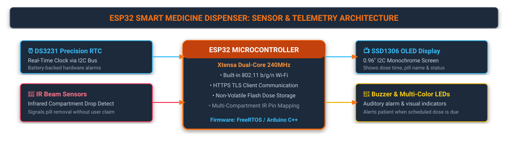
</div>

<br/>

<details>
<summary>🔍 <b>View ESP32 Telemetry Mermaid Code</b></summary>

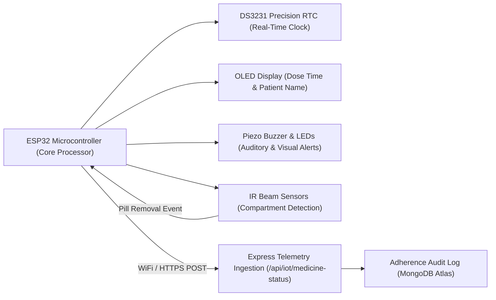

</details>

<br/>

### Telemetry Payload Specification

<p align="justify">
When a compartment is opened, the ESP32 firmware executes a TLS-secured HTTP POST request to the API gateway:
</p>

```json
{
  "deviceId": "ESP32_DISPENSER_A1",
  "patientId": "65e8a7199214731b5145b412",
  "medicineId": "65e8a7199214731b5145b499",
  "doseTime": "08:00",
  "status": "Taken",
  "sensorTriggered": "IR_BEAM_COMPARTMENT_1",
  "batteryLevel": 94,
  "timestamp": "2026-11-11T08:02:14.000Z"
}
```

<p align="justify">
If no pill removal is registered within 45 minutes of the scheduled dose, the status updates to <code>Missed</code>, prompting the backend notification service to dispatch alerts to the patient's mobile device and flag the record on the assigned Community Health Officer's dashboard.
</p>

---

## 📊 Demonstration Accounts & Quick Logins

<p align="justify">
MedScan-NCD includes a <strong>One-Click Quick Login Bar</strong> directly on the <code>/login</code> screen. All demonstration accounts are pre-configured with synthetic data:
</p>

<div align="center">

🔑 **Universal Demo Password:** `MedScanDemo!2026`

| Role | Demo Email Address | Persona & Clinical Demonstration Highlights |
| :---: | :--- | :--- |
| **Patient** | `synthetic.patient.a@example.com`<br/>*(or `patient@example.com`)* | **Aarav Sharma:** Baseline vitals, uploaded lab reports, live LightGBM/Framingham risk predictions, and active daily medication schedules. |
| **Doctor** | `doctor@example.com` | **Dr. Demo Clinician:** Assigned patient directory, longitudinal trajectory charts (BP & Glucose), OCR review, and prescription composer. |
| **CHO** | `cho@example.com` | **Community Health Officer:** 3 rural village catchments (Green Valley, Central, South), high-risk triage sorting, and referral workflows. |
| **Admin** | `admin@example.com` | **System Administrator:** Global user management, audit logs, and the Security & Resilience Demonstration Lab. |

</div>

---

## 💻 Getting Started & Local Installation

### System Prerequisites
- **Node.js:** `v18.x` or `v20.x` (LTS recommended)
- **Python:** `v3.10` or `v3.11`
- **MongoDB:** Local MongoDB daemon or free MongoDB Atlas cluster connection string
- **Git**

---

### Step 1: Clone Repository
```bash
git clone https://github.com/your-username/MedScan_NCD.git
cd MedScan_NCD
```

---

### Step 2: Configure & Launch Backend API Gateway
```bash
cd backend
npm install

# Initialize environment configuration
cp .env.example .env
```

Ensure your `backend/.env` file contains:
```env
PORT=5000
NODE_ENV=development
MONGODB_URI=mongodb://localhost:27017/medscan_ncd
JWT_ACCESS_SECRET=your_jwt_access_secret_key_minimum_32_characters
JWT_REFRESH_SECRET=your_jwt_refresh_secret_key_minimum_32_characters
DIABETES_ML_SERVICE_URL=http://localhost:8000
ML_SERVICE_URL=http://localhost:8000
AUTO_VERIFY_EMAIL=true
```

Run the faculty demo seeder to populate accounts, reports, and models:
```bash
npm run seed:faculty-demo
npm run dev
```
*API Gateway will run on `http://localhost:5000`.*

---

### Step 3: Launch Machine Learning Inference Microservice
Open a second terminal window:
```bash
cd ml_model/service
python -m venv venv

# Activate virtual environment
# Windows:
venv\Scripts\activate
# Linux/macOS:
# source venv/bin/activate

pip install -r requirements.txt
python -m uvicorn app:app --host 0.0.0.0 --port 8000 --reload
```
*Inference microservice will run on `http://localhost:8000` (API docs at `http://localhost:8000/docs`).*

---

### Step 4: Configure & Launch Client Web Application
Open a third terminal window:
```bash
cd frontend
npm install

# Initialize frontend environment
cp .env.example .env
```

Ensure `frontend/.env` contains:
```env
VITE_API_URL=http://localhost:5000/api
```

Start the Vite development server:
```bash
npm run dev
```

Open your browser and navigate to **`http://localhost:5173`**.

---

## 🔌 API Endpoints Reference

### Core Application Services
| HTTP Method | Route | Access Level | Description |
| :--- | :--- | :---: | :--- |
| `POST` | `/api/auth/login` | Public | Authenticates credentials and returns JWT bearer tokens |
| `POST` | `/api/auth/register` | Public | Registers a new patient with initial demographics |
| `PATCH`| `/api/patients/me/demographics` | Patient | Updates baseline physiological vitals (BP, Glucose, BMI) |
| `POST` | `/api/reports` | Patient, Doctor | Multi-part upload and dual-engine OCR text extraction |
| `PUT`  | `/api/reports/:id/confirm` | Patient, Doctor | Confirms extracted biomarkers into immutable record |
| `POST` | `/api/predictions/diabetes` | Patient, Doctor | Triggers calibrated LightGBM diabetes risk calculation |
| `POST` | `/api/predictions/heart-disease` | Patient, Doctor | Triggers Framingham 10-Year CHD risk assessment |
| `POST` | `/api/predictions/hypertension` | Patient, Doctor | Evaluates empirical hypertension risk boundary |
| `POST` | `/api/predictions/ckd` | Patient, Doctor | Evaluates Chronic Kidney Disease risk score |
| `GET`  | `/api/medicines` | Patient, Doctor | Retrieves active medication regimen and prescription details |
| `PATCH`| `/api/medicines/:id/status` | Patient | Manually toggles dose status (`Taken` / `Missed`) |
| `POST` | `/api/iot/medicine-status` | Hardware / IoT | Ingests ESP32 compartment sensor telemetry |
| `GET`  | `/api/security-lab/blackout-status`| Admin Only | Queries blackout simulator availability state |
| `POST` | `/api/security-lab/snapshot` | Admin Only | Captures byte-accurate synthetic dataset snapshot |
| `POST` | `/api/security-lab/restore` | Admin Only | Restores synthetic dataset and verifies SHA-256 hash |

---

## 📂 Project Directory Structure

```text
MedScan_NCD/
├── assets/                          # Repository documentation media
│   ├── demo/                        # Banner poster and media assets
│   │   ├── banner-poster.png        # Platform presentation banner
│   │   └── hero.png                 # Hero visualization
│   ├── diagrams/                    # Visual SVG architectural & process flowcharts
│   │   ├── 01-system-architecture.svg
│   │   ├── 02-interaction-sequence.svg
│   │   ├── 03-ocr-pipeline-flowchart.svg
│   │   └── 04-iot-telemetry-flowchart.svg
│   ├── plots/                       # SHAP beeswarm, calibration, PR, and ROC curves
│   └── screenshots/                 # Application screenshots & high-contrast SVGs
│       ├── 01-patient-dashboard.svg
│       ├── 02-ocr-upload-review.svg
│       ├── ai-disease-risk-cards.png
│       ├── 04-medicine-reminder-schedule.svg
│       ├── 05-doctor-clinical-portal.svg
│       ├── 06-cho-community-catchment.svg
│       ├── 07-admin-security-resilience-lab.svg
│       ├── 08-iot-smart-dispenser-hardware.svg
│       └── sample-lab-report-ocr.png
├── backend/                         # Node.js Express API Gateway
│   ├── src/
│   │   ├── config/                  # DB, Cloudinary, Swagger configs
│   │   ├── controllers/             # Auth, Patient, Report, Prediction, IoT controllers
│   │   ├── middleware/              # JWT auth, RBAC, error handling, rate limiting
│   │   ├── models/                  # Mongoose schemas (User, Patient, Report, Prediction, Medicine)
│   │   ├── routes/                  # Modular Express routers
│   │   ├── services/                # OCR engine, normalizer, ML clients, AES encryption
│   │   └── server.js                # Express entrypoint
│   └── scripts/                     # Faculty demo seeder and dataset migration scripts
├── frontend/                        # React 18 + Vite Web Application
│   ├── src/
│   │   ├── components/              # Reusable UI, OCR modals, charts, care team widgets
│   │   ├── context/                 # Auth, Theme, and Toast providers
│   │   ├── pages/                   # Patient, Doctor, CHO, Admin, and Security Lab pages
│   │   ├── services/                # Axios API services
│   │   └── App.jsx                  # Main application router
│   └── tailwind.config.js           # Tailwind CSS theme configuration
├── ml_model/                        # Python / FastAPI Machine Learning Microservice
│   ├── artifacts/                   # Serialized LightGBM & research model joblib files
│   ├── heart_disease/               # Serialized Framingham CHD pipeline artifacts
│   ├── service/                     # FastAPI inference microservice (app.py)
│   └── evaluation/plots/            # Benchmarking and TreeSHAP evaluation figures
└── docs/                            # In-depth architectural & faculty demo runbooks
    ├── demo/                        # Step-by-step presentation scripts, accounts catalog
    └── system-design/               # Security lab & blackout architecture specifications
```

---

## ⚖️ Clinical Disclaimer & Ethical Notice

<p align="justify">
<strong>IMPORTANT CLINICAL NOTICE:</strong> MedScan-NCD is an academic engineering demonstration platform and clinical decision-support research prototype. <strong>It is not certified as a medical diagnostic device under FDA, CE, or CDSCO medical device regulations.</strong>
</p>

<p align="justify">
1. <strong>Statistical Screening Tool:</strong> All disease risk scores represent statistical epidemiological correlations computed from population cohorts (such as NHANES and the Framingham Heart Study). They must never be interpreted as definitive medical diagnoses or biological certainties.<br/>
2. <strong>Physician Oversight Mandatory:</strong> No diagnostic conclusion, pharmaceutical dosage modification, or medical intervention should ever be made solely based on the outputs of this software without direct consultation with a licensed medical practitioner.<br/>
3. <strong>Hardware Telemetry Scope:</strong> The ESP32 smart medicine reminder tracks physical pill compartment activity via optical sensors; sensor confirmation does not constitute biochemical proof of biological ingestion.<br/>
4. <strong>Data Privacy & Protection:</strong> All patient data displayed in demonstration modes are completely synthetic and do not correspond to living individuals.
</p>

---

## 👥 Authors & Acknowledgments

- **Project Title:** AI-Based NCD Prediction and Smart Medicine Reminder System (*MedScan-NCD*)
- **Department:** Computer Science & Engineering / Healthcare Informatics
- **Academic Year:** 2025–2026

<p align="justify">
We express our sincere gratitude to our academic faculty mentors, clinical advisors, and the open-source engineering community whose research, toolkits, and open clinical datasets (NHANES, UCI Machine Learning Repository, Framingham Heart Study) made this interdisciplinary project possible.
</p>

<br/>

<div align="center">
  <sub>Built with ❤️ for accessible, intelligent, and proactive healthcare delivery.</sub>
</div>
