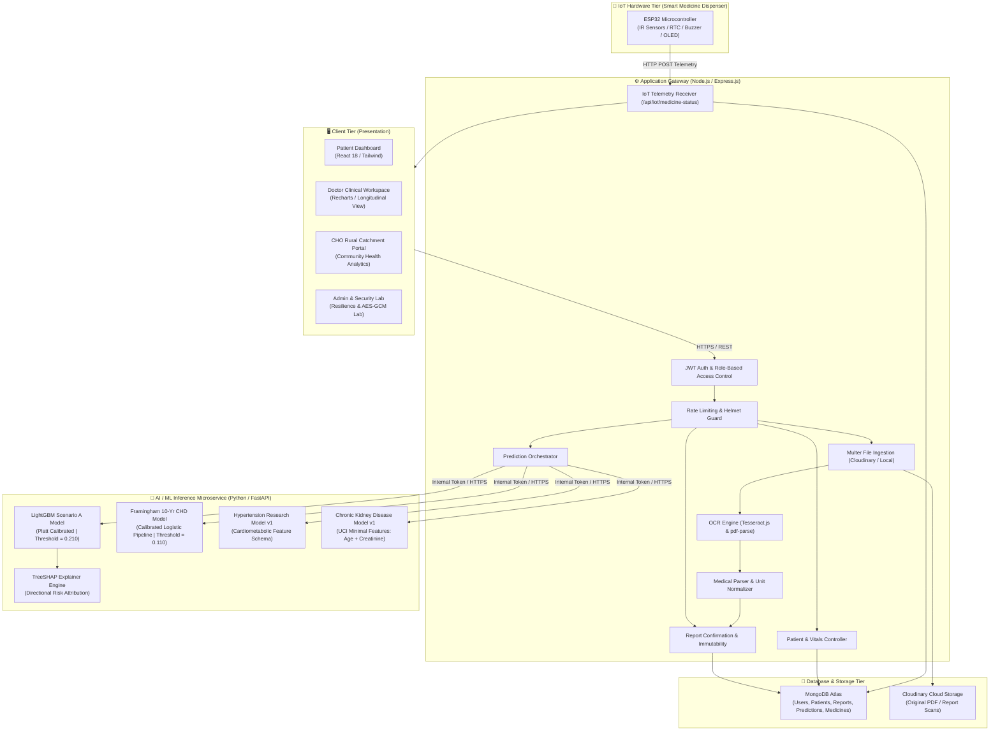

<div align="center">

# 🩺 MedScan-NCD
### **AI-Assisted Non-Communicable Disease Prediction & Smart Medicine Dispensing Platform**

[](https://react.dev/)
[](https://vitejs.dev/)
[](https://tailwindcss.com/)
[](https://nodejs.org/)
[](https://expressjs.com/)
[](https://www.mongodb.com/atlas)
[](https://www.python.org/)
[](https://fastapi.tiangolo.com/)
[](https://lightgbm.readthedocs.io/)
[](LICENSE)

<br/>

> **MedScan-NCD** is a full-stack clinical decision support and medication tracking ecosystem that bridges the gap between diagnostic laboratory data, clinical risk assessment, and daily patient medication adherence. By combining **Optical Character Recognition (OCR)**, **interpretable machine learning (TreeSHAP)**, and **IoT smart dispenser telemetry**, MedScan-NCD empowers patients, doctors, and rural Community Health Officers (CHOs) with early risk detection and real-world therapy adherence.

<br/>


</div>

---

## 📑 Table of Contents

- [🌟 System Overview](#-system-overview)
- [🎬 Demonstration Video & Screenshots](#-demonstration-video--screenshots)
- [🏗️ System Architecture](#️-system-architecture)
- [🚀 Key Modules & Role Workspaces](#-key-modules--role-workspaces)
  - [1. Patient Health & Risk Workspace](#1-patient-health--risk-workspace)
  - [2. Clinician / Doctor Portal](#2-clinician--doctor-portal)
  - [3. Community Health Officer (CHO) Rural Screening Portal](#3-community-health-officer-cho-rural-screening-portal)
  - [4. Admin Portal & Security Demonstration Lab](#4-admin-portal--security-demonstration-lab)
  - [5. IoT Smart Medicine Reminder & Dispenser Telemetry](#5-iot-smart-medicine-reminder--dispenser-telemetry)
- [🔬 OCR & Document Understanding Pipeline](#-ocr--document-understanding-pipeline)
- [🧠 Machine Learning Models & Explainability](#-machine-learning-models--explainability)
- [🛡️ Security, Reliability & Resilience Lab](#️-security-reliability--resilience-lab)
- [📊 Demonstration Accounts & Quick Logins](#-demonstration-accounts--quick-logins)
- [💻 Getting Started & Local Installation](#-getting-started--local-installation)
- [🔌 API Endpoints & IoT Telemetry Contract](#-api-endpoints--iot-telemetry-contract)
- [📂 Project Directory Structure](#-project-directory-structure)
- [⚖️ Clinical Disclaimer & Ethical Notice](#️-clinical-disclaimer--ethical-notice)
- [👥 Authors & Acknowledgments](#-authors--acknowledgments)

---

## 🌟 System Overview

Non-Communicable Diseases (NCDs)—predominantly **Type-2 Diabetes**, **Cardiovascular Diseases (CHD)**, **Hypertension**, and **Chronic Kidney Disease (CKD)**—account for over 70% of global deaths. In community and rural healthcare settings, diagnosis is often delayed due to inaccessible diagnostics, paper-based lab reports, fragmented health records, and low medication adherence.

**MedScan-NCD solves this challenge through a multi-tier pipeline:**

1. **Instant Medical Report Digitization:** Converts printed or photographic diagnostic reports (PDF/JPG/PNG) into structured, unit-normalized clinical biomarkers via Tesseract OCR and digital PDF parsers.
2. **Human-in-the-Loop Clinical Verification:** Enables patients or healthcare providers to review, verify, and correct machine-extracted data prior to entering permanent health snapshots.
3. **Calibrated Multi-Disease Risk Models:** Calculates statistical risk probabilities using state-of-the-art algorithms (calibrated **LightGBM**, **Framingham CHD**, and research models) with directional **TreeSHAP** factor importance.
4. **Smart Medicine Scheduling & IoT Telemetry:** Tracks daily pill compliance with bidirectional sync between the web dashboard and an ESP32 microcontroller-based physical pill reminder box.
5. **System Resilience & Data Protection:** Built-in cryptographic defense (**AES-256-GCM**) and disaster recovery simulation with point-in-time snapshot restore for institutional demonstrations.

---

## 🎬 Demonstration Video & Screenshots

### 🎥 Live Video Demonstration

> **Watch the full software workflow demonstration video:**
>
> [](https://drive.google.com/)  
> *(Click the image above to view the demonstration video or find the recording file in `assets/demo/`)*
>
> *Note: If you have a local demonstration MP4, you can place it at `assets/demo/medscan-demo-video.mp4` or embed your hosted link here.*

---

### 📸 Platform Visual Showcase

<div align="center">

| AI Multi-Disease Risk Engine | Extracted Laboratory Report |
| :---: | :---: |
| <br/>*Real-time risk estimation across Diabetes, Heart Disease, Hypertension, and CKD* | <br/>*Scanned Diagnostic Report used for automated OCR extraction* |

| TreeSHAP Directional Feature Contributions | Platt Model Calibration Curve |
| :---: | :---: |
| <br/>*TreeSHAP directional explainability showing impact of biomarkers on risk* | <br/>*5-Fold Sigmoid Platt calibration ensuring reliable clinical probability scores* |

| ROC Curve Comparison (AUC = 0.835) | Precision-Recall Tradeoff Curve |
| :---: | :---: |
| <br/>*Receiver Operating Characteristic benchmarking LightGBM vs baselines* | <br/>*Calibrated decision threshold (0.210) balancing sensitivity and specificity* |

</div>

> 💡 **Adding your own screenshots:**  
> Drop your high-resolution PNGs into `assets/screenshots/` (e.g., `01-patient-dashboard.png`, `02-ocr-modal.png`, `03-medicine-schedule.png`, `04-doctor-portal.png`) to customize this gallery.

---

## 🏗️ System Architecture

MedScan-NCD employs a **three-tier microservices architecture** separated into a Client Application, an Express.js API Gateway, and a Python/FastAPI Machine Learning Inference Microservice:



---

## 🚀 Key Modules & Role Workspaces

### 1. Patient Health & Risk Workspace
* **Longitudinal Biomarkers Snapshot:** Displays resting Blood Pressure, Fasting Blood Glucose, Total Cholesterol, HDL, Serum Creatinine, Blood Urea, Hemoglobin, and BMI.
* **Document Upload & OCR Review:** Drag-and-drop report uploader with auto-classification into CBC, Lipid Panel, Renal Function, or ABPM reports.
* **Human-in-the-Loop Safety:** Review modal highlights out-of-range biomarkers in yellow/red warnings before committing data to the profile.
* **Live AI Disease Risk Cards:** Interactive risk probability meters with color-coded risk categories and plain-English preventative recommendations.
* **Care Team Association:** Displays the patient's assigned primary physician and community health worker.

### 2. Clinician / Doctor Portal
* **Assigned Patient Roster:** Quick search and filtering across assigned patient cohorts.
* **Longitudinal Trajectory Charts:** Visual time-series tracking of blood glucose, systolic/diastolic blood pressure, and renal markers across sequential visits.
* **Clinical Decision Support:** Access to raw OCR extracts, confirmed biomarkers, and underlying ML model confidence metrics.
* **Prescription & Regimen Management:** Prescribe medications with dosage, frequency, specific schedule times, and clinical intake notes.

### 3. Community Health Officer (CHO) Rural Screening Portal
* **Village Catchment Surveillance:** Aggregated health metrics across assigned rural communities (e.g., Green Valley, Demo Central, South, East).
* **High-Risk Beneficiary Triage:** Automated sorting of patients exceeding risk thresholds for diabetes or hypertensive crisis.
* **Follow-Up & Home Visit Scheduler:** Track overdue, pending, and completed rural community follow-ups.
* **Tertiary Hospital Referrals:** Formal digital referral workflows linking village patients to district hospitals and specialists.

### 4. Admin Portal & Security Demonstration Lab
* **Global Access Directory:** Secure user account management, role re-assignments, and platform audit logs.
* **Database Blackout & Snapshot Recovery Engine:** Faculty demonstration module simulating complete database failure (HTTP 503), data loss, snapshot restoration, and deterministic SHA-256 integrity verification.
* **Medical Data Breach & Cryptographic Defense:** Demonstrates raw database dumps in plaintext vs. application-level **AES-256-GCM** ciphertext with automated tampering rejection.

### 5. IoT Smart Medicine Reminder & Dispenser Telemetry
* **Automated Dose Sync:** Schedules created in the patient portal sync with the hardware dispenser.
* **Telemetry Telemetry Ingestion (`/api/iot/medicine-status`):** ESP32 dispenser transmits pill compartment status (`Taken` or `Missed`) via secure JSON telemetry.
* **Adherence Auditing:** Generates real-time compliance logs without relying on unverified user claims.

---

## 🔬 OCR & Document Understanding Pipeline

```
[ Diagnostic Report (PDF or Scan) ]
                │
                ▼
   [ Multer Multi-Part Ingestion ]
                │
         ┌──────┴──────┐
         ▼             ▼
   [ pdf-parse ]  [ Tesseract.js ]
   (Digital PDF)   (Optical Scans)
         └──────┬──────┘
                ▼
   [ Medical Entity Classifier ]
    (Lipid Panel, ABPM, CBC, Renal)
                │
                ▼
    [ Regex & Unit Normalizer ]
    (e.g., mmol/L -> mg/dL, mmHg)
                │
                ▼
 [ Human-in-the-Loop Review Modal ]
    (Edit, Correct, or Accept)
                │
                ▼
  [ Confirmed Immutable Report ]
```

1. **Dual Ingestion Engine:** Digital PDFs bypass optical degradation via stream extraction; image scans run through Tesseract OCR with adaptive contrast filters.
2. **Deterministic Canonical Mapping:** Maps varied clinical naming conventions (e.g., `FBS`, `Fasting Blood Sugar`, `B.Sugar(F)`) to unified schema fields.
3. **Biological Range Validation:** Verifies values against physiological safety bounds:
   - Systolic BP: $60 - 260\text{ mmHg}$
   - Diastolic BP: $30 - 150\text{ mmHg}$
   - Fasting Glucose: $40 - 500\text{ mg/dL}$
   - Serum Creatinine: $0.1 - 20.0\text{ mg/dL}$

---

## 🧠 Machine Learning Models & Explainability

All prediction algorithms are decoupled into a dedicated Python/FastAPI microservice, ensuring zero disruption to primary application routes during compute-heavy inference:

| Condition | Base Algorithm | Training Dataset | Calibration & Decision Threshold | Key Features Utilized |
| :--- | :--- | :--- | :--- | :--- |
| **Type-2 Diabetes** | **LightGBM** Classifier | NHANES Cardiometabolic Cohort | 5-Fold Sigmoid (Platt) Scaling<br/>**Threshold: 0.210** | Age, Sex, BMI, Systolic BP, Diastolic BP, Total Cholesterol, HDL, Serum Creatinine |
| **Heart Disease** | **Framingham 10-Yr CHD** | Framingham Heart Study | Calibrated Logistic Pipeline<br/>**Threshold: 0.110** | Age, Sex, Total Cholesterol, Systolic BP, Diastolic BP, BMI, Fasting Glucose, Smoking Status |
| **Hypertension** | **Research Ensemble v1** | Clinical Risk Cohort | Empirical Decision Boundary<br/>**Threshold: ~0.331** | Age, Sex, BMI, Fasting Glucose, Total Cholesterol, HDL, Creatinine, Heart Rate, Smoking |
| **Chronic Kidney Disease** | **Minimal UCI Model v1** | UCI Kidney Disease Dataset | Minimal Robust Boundary<br/>**Threshold: ~0.967** | Adult Age, Serum Creatinine ($>0$) |

### 🔍 TreeSHAP Explainability Engine
Rather than presenting patients with black-box outputs, the platform utilizes **TreeSHAP (SHapley Additive exPlanations)** to calculate exact directional contributions:
* **Higher Estimated Risk:** Factors pushing probability higher (e.g., Age = 58, Fasting Glucose = 145 mg/dL).
* **Lower Estimated Risk:** Protective factors reducing probability (e.g., HDL = 55 mg/dL, Diastolic BP = 78 mmHg).

---

## 🛡️ Security, Reliability & Resilience Lab

An academic-grade **Security & Resilience Demonstration Lab** is integrated at `/admin/security-lab`:

### Concept 1: Database Blackout & Snapshot Restore Engine
- **Failure Injection:** Simulates an unreachable database cluster returning sanitized HTTP 503 Service Unavailable responses without leaking stack traces.
- **Data Loss Simulation:** Demonstrates active record wiping on an isolated synthetic partition (3 records $\rightarrow$ 0).
- **Point-in-Time Restore:** Recovers records from an independent snapshot and computes a real-time **SHA-256 integrity hash** to prove zero record corruption.

### Concept 2: Medical Data Breach & Cryptographic Defense
- **AES-256-GCM Encryption:** Encrypts sensitive fields (Patient Name, Village, Blood Pressure, Fasting Glucose) using AES-256 in Galois/Counter Mode with 96-bit unique IVs.
- **Breach Exposure Comparison:** Shows side-by-side comparison between plaintext leakage vs. AES-256-GCM ciphertext.
- **GHASH Tamper Rejection:** Demonstrates automated rejection of tampered ciphertext via 128-bit authentication tags.

---

## 📊 Demonstration Accounts & Quick Logins

The application features a **One-Click Demo Login** bar on the `/login` screen. All synthetic demo accounts use the standard password:

🔑 **Universal Demo Password:** `MedScanDemo!2026`

| Role | Demo Email | Persona & Demonstration Purpose |
| :--- | :--- | :--- |
| **Patient** | `synthetic.patient.a@example.com`<br/>*(or `patient@example.com`)* | **Aarav Sharma:** Baseline & follow-up reports, vitals tracking, active prescriptions. |
| **Doctor** | `doctor@example.com` | **Dr. Demo Clinician:** Patient roster, consultation review, longitudinal charts. |
| **CHO** | `cho@example.com` | **Community Health Officer:** 3 village catchments, high-risk screening, referrals. |
| **Admin** | `admin@example.com` | **Administrator:** System configuration, audit logs, Security & Resilience Lab. |

---

## 💻 Getting Started & Local Installation

### Prerequisites
- **Node.js:** v18.x or v20.x
- **Python:** v3.10 or v3.11
- **MongoDB:** Local MongoDB instance or free MongoDB Atlas URI
- **Git**

---

### Step 1: Clone the Repository
```bash
git clone https://github.com/your-username/MedScan_NCD.git
cd MedScan_NCD
```

---

### Step 2: Set Up Backend Environment & Install Dependencies
```bash
cd backend
npm install

# Create environment configuration
cp .env.example .env
```

Configure your `backend/.env` with:
```env
PORT=5000
NODE_ENV=development
MONGODB_URI=mongodb://localhost:27017/medscan_ncd
JWT_ACCESS_SECRET=your_jwt_access_secret_key_minimum_32_characters
JWT_REFRESH_SECRET=your_jwt_refresh_secret_key_minimum_32_characters
DIABETES_ML_SERVICE_URL=http://localhost:8000
ML_SERVICE_URL=http://localhost:8000
AUTO_VERIFY_EMAIL=true
```

---

### Step 3: Set Up Machine Learning Microservice
```bash
cd ../ml_model/service
python -m venv venv

# Windows
venv\Scripts\activate
# Linux/macOS
# source venv/bin/activate

pip install -r requirements.txt
```

---

### Step 4: Set Up Frontend Application
```bash
cd ../../frontend
npm install

# Create frontend environment configuration
cp .env.example .env
```

Ensure `frontend/.env` contains:
```env
VITE_API_URL=http://localhost:5000/api
```

---

### Step 5: Seed Demonstration Data
From the `backend/` folder:
```bash
cd ../backend
npm run seed:faculty-demo
```
*(Seeds all 4 demo roles, patient cohorts, verified diagnostic reports, and ML prediction history).*

---

### Step 6: Run the Complete Application

Open three separate terminals:

```bash
# Terminal 1: Machine Learning Microservice (Port 8000)
cd ml_model/service
python -m uvicorn app:app --host 0.0.0.0 --port 8000

# Terminal 2: Node.js Express API (Port 5000)
cd backend
npm run dev

# Terminal 3: Vite React Client (Port 5173)
cd frontend
npm run dev
```

Visit **`http://localhost:5173`** in your browser.

---

## 🔌 API Endpoints & IoT Telemetry Contract

### Core Application Endpoints
| Method | Endpoint | Access | Purpose |
| :--- | :--- | :--- | :--- |
| `POST` | `/api/auth/login` | Public | Authenticates credentials and returns JWT access tokens |
| `PATCH`| `/api/patients/me/demographics` | Patient | Updates confirmed clinical baseline vitals |
| `POST` | `/api/reports` | Patient, Doctor | Ingests report file and executes Tesseract / PDF extraction |
| `PUT`  | `/api/reports/:id/confirm` | Patient, Doctor | Formally confirms extracted biomarkers into patient record |
| `POST` | `/api/predictions/diabetes` | Patient, Doctor | Calculates calibrated LightGBM diabetes risk probability |
| `POST` | `/api/predictions/heart-disease` | Patient, Doctor | Evaluates Framingham 10-Year CHD cardiovascular risk |
| `POST` | `/api/predictions/hypertension` | Patient, Doctor | Evaluates hypertension classification estimate |
| `POST` | `/api/predictions/ckd` | Patient, Doctor | Evaluates Chronic Kidney Disease risk score |
| `GET`  | `/api/medicines` | Patient, Doctor | Retrieves active medication regimen and prescription details |
| `PATCH`| `/api/medicines/:id/status` | Patient | Updates dose status (`Taken` or `Missed`) |

### 📡 ESP32 Smart Dispenser Telemetry Contract
The physical dispenser transmits pill compartment events via:

`POST /api/iot/medicine-status`

```json
{
  "deviceId": "ESP32_DISPENSER_01",
  "patientId": "65e8a7199214731b5145b412",
  "medicineId": "65e8a7199214731b5145b499",
  "status": "Taken",
  "timestamp": "2026-11-11T08:00:00.000Z"
}
```

*When status is `Missed`, the backend automatically generates a priority notification to the patient and assigned CHO.*

---

## 📂 Project Directory Structure

```text
MedScan_NCD/
├── assets/                          # Repository documentation media
│   ├── demo/                        # Banner poster, video links
│   ├── plots/                       # SHAP beeswarm, calibration & ROC curves
│   └── screenshots/                 # Application UI screenshots
├── backend/                         # Node.js Express API Gateway
│   ├── src/
│   │   ├── config/                  # DB, Cloudinary, Swagger configs
│   │   ├── controllers/             # Auth, Patient, Report, Prediction, IoT controllers
│   │   ├── middleware/              # JWT auth, RBAC, error handling, rate limiting
│   │   ├── models/                  # Mongoose schemas (User, Patient, Report, Prediction, Medicine)
│   │   ├── routes/                  # Modular Express routers
│   │   ├── services/                # OCR engine, medical normalizer, ML clients, encryption
│   │   └── server.js                # Express entrypoint
│   └── scripts/                     # Faculty demo seeding & migration scripts
├── frontend/                        # React 18 + Vite Web Application
│   ├── src/
│   │   ├── components/              # Reusable UI, OCR modals, charts, care team widgets
│   │   ├── context/                 # Auth, Theme, and Toast providers
│   │   ├── pages/                   # Patient, Doctor, CHO, Admin, and Security Lab pages
│   │   ├── services/                # Axios API services
│   │   └── App.jsx                  # Main application router
│   └── tailwind.config.js           # Tailwind CSS theme configuration
├── ml_model/                        # Python / FastAPI Machine Learning Microservice
│   ├── artifacts/                   # Serialized LightGBM & research model joblib files
│   ├── heart_disease/               # Serialized Framingham CHD pipeline artifacts
│   ├── service/                     # FastAPI inference microservice (app.py)
│   └── evaluation/plots/            # Benchmarking and TreeSHAP evaluation figures
└── docs/                            # In-depth architectural & faculty demo runbooks
    ├── demo/                        # Step-by-step presentation guides, accounts catalog
    └── system-design/               # Security lab & blackout architecture specifications
```

---

## ⚖️ Clinical Disclaimer & Ethical Notice

> ⚠️ **Important Clinical Decision Support Notice:**  
> **MedScan-NCD is an engineering demonstration platform and research clinical decision-support tool. It is NOT a certified medical diagnostic device.**
>
> - The risk probabilities generated by this software represent statistical associations derived from population cohorts (such as NHANES and the Framingham Heart Study).
> - Predictions must never be construed as definitive medical diagnoses.
> - Medication intake records recorded via the IoT interface represent pill compartment pickup telemetry and should not be used as proof of biological ingestion without clinical supervision.
> - Patients should always consult qualified healthcare professionals before altering medication or treatment plans.

---

## 👥 Authors & Acknowledgments

* **Project Title:** AI-Based NCD Prediction and Smart Medicine Reminder System (*MedScan-NCD*)
* **Department:** Computer Science & Engineering / Healthcare Informatics
* **Academic Year:** 2025–2026

Special thanks to our project mentors, healthcare advisors, and the open-source community for providing the tools and datasets that made this work possible.

---

<div align="center">
  <sub>Built with ❤️ for accessible, intelligent, and proactive healthcare delivery.</sub>
</div>

