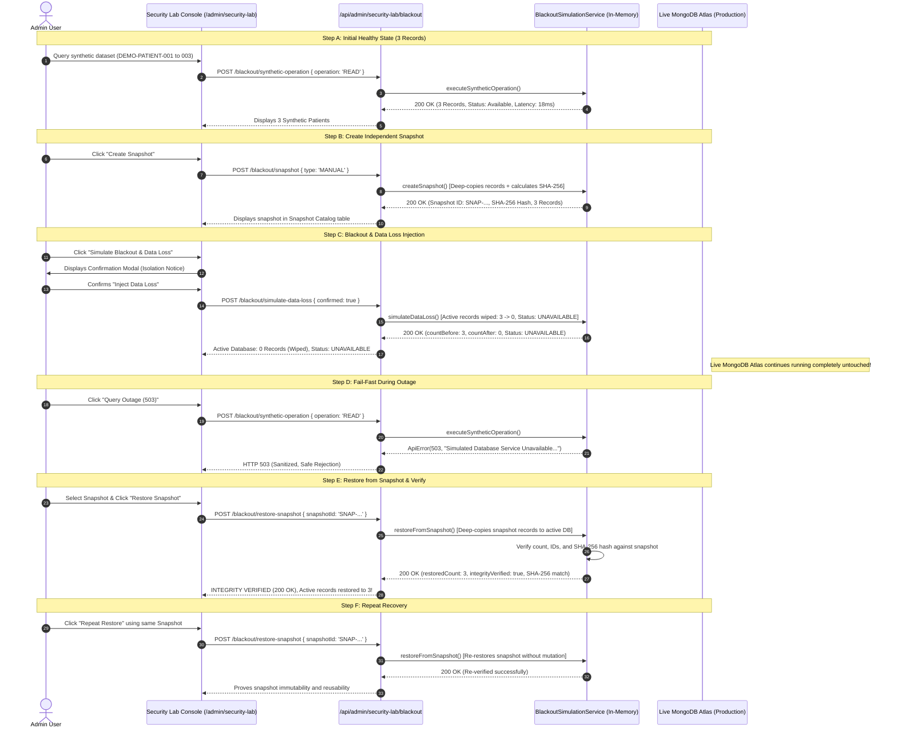

# MedScan-NCD System Design: Database Blackout, Snapshot & Recovery Simulation

## 1. Overview & Core Engineering Problem

In healthcare SaaS platforms, disaster recovery and data protection are fundamental requirements. A frequent misconception during engineering reviews is conflating **High Availability (Replication/Failover)** with **Disaster Recovery (Point-in-Time Snapshots)**:

- **High Availability (Replica Sets)**: If a MongoDB primary node crashes, the secondary nodes elect a new primary. However, if a software bug, operator error, or malicious script executes `deleteMany({})` or corrupts records, **the replica set faithfully replicates the deletion/corruption to all nodes within milliseconds**.
- **Point-in-Time Snapshots**: A true snapshot is an immutable, independent copy of the dataset captured at a specific timestamp with a cryptographic checksum. When data loss occurs, the system can reconstruct the dataset back to that exact verified state.

The **Database Blackout, Snapshot & Recovery Simulation** demonstrates this exact architectural lifecycle:
1. Capturing an independent deep-copy snapshot with a SHA-256 checksum.
2. Demonstrating snapshot immutability (mutations in the active database do not alter existing snapshots).
3. Simulating a catastrophic blackout & data loss incident (active synthetic records drop from 3 → 0, and the database transitions to UNAVAILABLE).
4. Demonstrating graceful fail-fast behavior with sanitized HTTP 503 responses and zero state corruption.
5. Performing point-in-time restoration from a selected snapshot.
6. Deterministically verifying data integrity via record counts, record identifiers, and SHA-256 hash comparisons (`INTEGRITY_VERIFIED`).
7. Demonstrating repeat recovery from the same snapshot.



---

## 2. Walkthrough Steps (A → F)

### Step A: Initial Healthy State
- **State**: The simulation engine reports `simulatedStatus: "HEALTHY"`.
- **Dataset**: Initialized with 3 deterministic seed records:
  - `DEMO-PATIENT-001` (Aarav Demo, Report: `DEMO-REPORT-001`)
  - `DEMO-PATIENT-002` (Diya Demo, Report: `DEMO-REPORT-002`)
  - `DEMO-PATIENT-003` (Rohan Demo, Report: `DEMO-REPORT-003`)
- **Action**: Admin clicks **Test Read (200)**.
- **Observed Behavior**:
  - Response Code: `HTTP 200 OK`.
  - Latency: ~15-25ms.
  - Returns all 3 synthetic records.

### Step B: Create Independent Snapshot
- **Action**: Admin clicks **Create Snapshot**.
- **Backend Operation**:
  1. Deep-clones the active synthetic records array using `JSON.parse(JSON.stringify(records))`.
  2. Generates unique snapshot ID: `SNAP-<timestamp>-<random-hex>`.
  3. Computes canonical SHA-256 checksum over sorted record JSON:
     ```javascript
     const sorted = [...records].sort((a, b) => a.demoPatientId.localeCompare(b.demoPatientId));
     const hash = crypto.createHash('sha256').update(JSON.stringify(sorted)).digest('hex');
     ```
  4. Stores the snapshot in the isolated simulation snapshot catalog (bounded to max 10 entries).
  5. Displays snapshot in the **Snapshot History Table**.
- **Immutability Invariant**: Mutating or updating the active dataset afterwards does not alter the stored snapshot.

### Step C: Simulate Blackout & Data Loss
- **Action**: Admin clicks **Simulate Loss**.
- **Confirmation Modal**: Explicitly reminds the Admin:
  > *"This scenario wipes all active in-memory synthetic records (3 → 0) and sets the simulated database to UNAVAILABLE. The live MedScan-NCD database and production patients will NOT be modified."*
- **Backend Operation**:
  1. Records count before deletion (3).
  2. Sets `simulatedStatus = "UNAVAILABLE"`.
  3. Wipes active synthetic records (`syntheticRecords = []`).
  4. Logs timeline event: `DATA_LOSS_SIMULATED`.
- **Observed Behavior**:
  - Active Records counter drops to `0`.
  - Inspector shows amber banner: `Active Synthetic Database is Empty (0 Records)`.
  - Live MongoDB Atlas status remains green: `Online (Untouched)`.

### Step D: Fail-Fast Rejection
- **Action**: Admin clicks **Query Outage (503)**.
- **Observed Behavior**:
  - Response Code: `HTTP 503 Service Unavailable`.
  - Sanitized Error Body:
    ```json
    {
      "statusCode": 503,
      "message": "Simulated Database Service Unavailable: The isolated demonstration database connection is currently unreachable. Request safely rejected without data corruption.",
      "success": false
    }
    ```
  - Proves the system fails fast rather than hanging or returning fabricated success.

### Step E: Restore from Snapshot & Integrity Verification
- **Action**: Admin selects snapshot from the table and clicks **Restore Snapshot**.
- **Backend Operation**:
  1. Validates `snapshotId` exists in the simulation catalog.
  2. Deep-copies snapshot records into `syntheticRecords`.
  3. Sets `simulatedStatus = "HEALTHY"`.
  4. Computes SHA-256 hash of restored records and compares with `snapshot.integrityHash`.
  5. Validates record count matches (`3 === 3`) and all `demoPatientId` keys match.
- **Observed Behavior**:
  - Status updates to `HEALTHY`.
  - Verification Badge: `INTEGRITY_VERIFIED` (`verified: true`).
  - Active records restored to 3.
  - Measured Duration: ~15.5ms.

### Step F: Repeat Recovery
- **Action**: Admin clicks **Repeat Restore**.
- **Observed Behavior**:
  - The exact same snapshot can be restored repeatedly without data degradation.
  - Proves that the snapshot was not consumed or corrupted during the first restoration.

---

## 3. Periodic Snapshot Scheduler Demonstration

In addition to manual snapshots, the console provides an optional in-memory **Periodic Snapshot Scheduler**:
- Configurable interval (defaults to 15 seconds, bounded between 10s and 60s).
- Labeled `SIMULATED_PERIODIC` in the snapshot history table.
- Bounded to max 10 entries to prevent memory leaks.
- Automatically cleaned up on server shutdown or reset.

---

## 4. Comparison Matrix: Disaster Recovery Metrics

| Metric | Before Loss (Step A/B) | During Loss (Step C/D) | Restored State (Step E/F) |
| :--- | :--- | :--- | :--- |
| **Simulated Status** | `HEALTHY` | `UNAVAILABLE` | `HEALTHY` |
| **Active Synthetic Records** | 3 records | 0 records (Wiped) | 3 records |
| **HTTP Response** | `200 OK` | `503 Service Unavailable` | `200 OK` |
| **Integrity Verification** | Baseline Active | Inactive / Lost | `INTEGRITY_VERIFIED` |
| **SHA-256 Checksum** | Matches Seed | N/A (Empty) | Exact Match to Snapshot |
| **Live MongoDB Atlas** | Online (`readyState: 1`) | Online (`readyState: 1`) | Online (`readyState: 1`) |
| **Production Disruption** | Zero | Zero | Zero |

---

## 5. Limitations & Simulation Scope

1. **In-Memory Demonstration**: This demonstration models snapshot creation, data loss, and point-in-time restoration in server memory using deep-copy cloning and SHA-256 hashing. It is **not** a production MongoDB Atlas snapshot runner or cloud backup driver.
2. **Production Backup Scope**: Production disaster recovery for MedScan-NCD utilizes MongoDB Atlas automated continuous cloud backups and oplog point-in-time recovery, which operate outside of this application demonstration environment.
