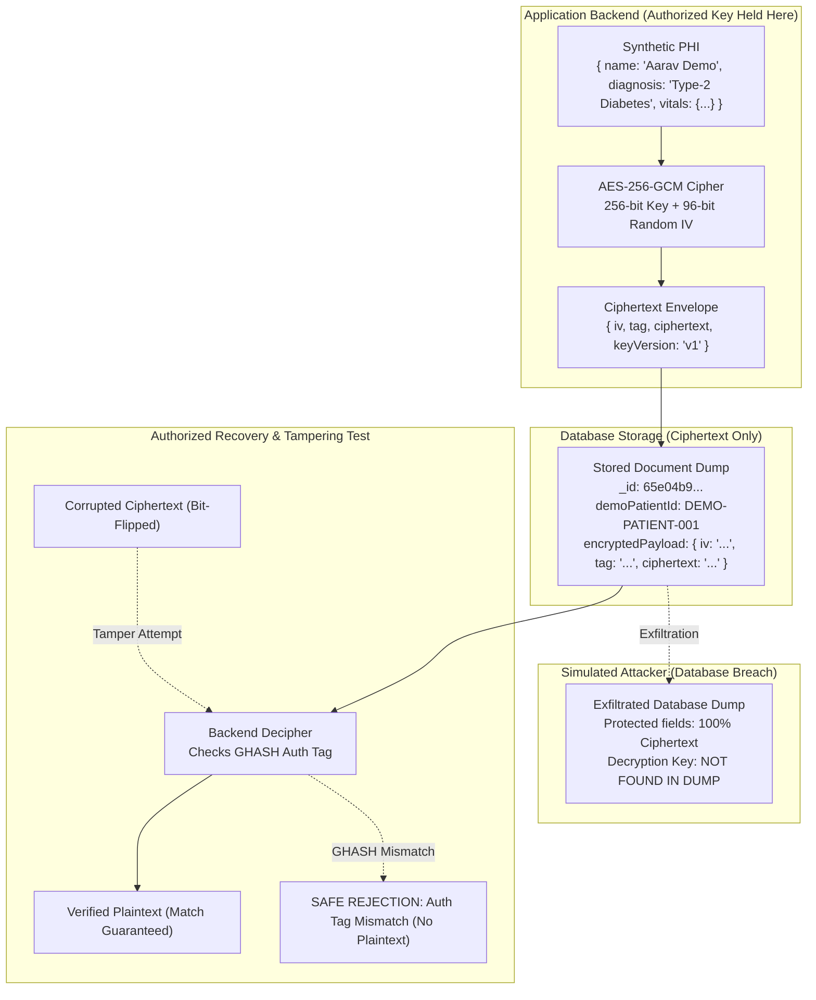

# MedScan-NCD System Design: Medical Data Breach & Application-Level Encryption

## 1. Overview & Threat Model

Healthcare applications store highly sensitive Protected Health Information (PHI) subject to regulatory frameworks such as HIPAA and DPDP. A common vulnerability in standard deployments is relying solely on transparent disk encryption (TDE) provided by the cloud database host (e.g., MongoDB Atlas encryption-at-rest).

### The Threat Boundary Problem
- **Transparent Disk Encryption (TDE)** protects the physical hardware if a hard drive is stolen from a cloud datacenter.
- **However**, if an attacker gains database credentials, dumps the database over compromised network credentials, or exfiltrates a `.json` / `.bson` backup file, **TDE offers zero protection** because the database engine transparently decrypts the data before exporting it.

### The Solution: Application-Level Encryption (ALE)
With application-level encryption:
1. Sensitive fields (`name`, `diagnosis`, `vitals`, `sampleMedicalField`) are encrypted **inside the backend Node.js process** before sending the document to MongoDB.
2. The database stores only AES-256-GCM ciphertext, nonces, and authentication tags.
3. The cryptographic key is **never stored in the database**—it resides strictly in the application server environment or an external Key Management Service (KMS).
4. If an attacker dumps the database, the extracted records contain only unreadable ciphertext.



---

## 2. Walkthrough Stages (A → D)

### Stage A: Baseline Synthetic Record
- Displays the readable synthetic demo record:
  ```json
  {
    "demoPatientId": "DEMO-PATIENT-001",
    "name": "Aarav Demo",
    "reportId": "DEMO-REPORT-001",
    "sampleMedicalField": "SYNTHETIC_VALUE",
    "diagnosis": "Synthetic Type-2 Diabetes Risk Simulation",
    "vitals": {
      "systolicBp": 128,
      "diastolicBp": 82,
      "fastingBloodSugar": 110,
      "hba1c": 6.2
    },
    "datasetType": "SYNTHETIC_DEMO_ONLY"
  }
  ```
- **Banner**: `SYNTHETIC DATA — NOT A REAL PATIENT RECORD`.

### Stage B: Encrypt & Store
- Admin clicks **Encrypt Synthetic Record**.
- Backend executes `securityLabEncryptionService.encryptSyntheticRecord()`.
- Cryptographic details returned:
  - Algorithm: `aes-256-gcm`
  - Key Version: `v1`
  - IV (Nonce): 12-byte random hex string (e.g., `4a1f9c8e...`)
  - Auth Tag: 16-byte GHASH tag (e.g., `b2e4d01a...`)
  - Ciphertext: Hex string representing encrypted sensitive fields.
  - Duration: Measured in milliseconds (~0.5 - 2.5ms).
- **Key Security Guarantee**: The 256-bit demonstration key is omitted from the response.

### Stage C: Simulated Database-Only Breach
- Admin clicks **Simulate Database-Only Breach**.
- Renders the raw document format as an attacker would see it in a MongoDB collection dump.
- **Side-by-Side Comparison**:
  - **Left**: Pre-encryption plaintext fields.
  - **Right**: Stored ciphertext envelope and public identifiers.
- Demonstrates that even with full read access to the database collection, the attacker cannot read diagnoses, names, or vitals.

### Stage D: Authorized Decryption & Tampering Resistance
1. **Authorized Decryption**:
   - Admin clicks **Decrypt with Server Key**.
   - Backend loads the server key, sets the auth tag, deciphers the ciphertext, and validates field equality against original data.
   - Status: `PASSED_INTEGRITY_VERIFIED` (~1-3ms).
2. **Ciphertext Tampering Resistance**:
   - Admin clicks **Test Ciphertext Tampering**.
   - The backend flips a bit in a copy of the ciphertext at its midpoint.
   - Decipher attempts to verify the GHASH authentication tag via `decipher.final()`.
   - **Result**: Decryption throws `Unsupported state or unable to authenticate data`.
   - The server catches this error, flags `tamperingDetected: true`, and guarantees `plaintextExposed: false`.
   - The original valid synthetic record remains intact for subsequent tests.

---

## 3. Threat Model Boundaries

The UI explicitly explains the three healthcare threat model tiers:

1. **Database-Only Compromise (Defended)**:
   - Attacker obtains MongoDB storage files or backup dumps.
   - ALE protects the payload because the key is stored outside the database.
2. **Application Key Compromise (Acknowledged Risk)**:
   - If an attacker compromises backend server environment variables or AWS/GCP KMS credentials, they can decrypt the ciphertext.
   - Defense: Secret rotation, role separation, hardware security modules (HSM).
3. **Trusted Application / Hijacked Session Compromise (Beyond Encryption)**:
   - If an attacker steals an active Doctor or Admin JWT session, the application itself will decrypt and display data.
   - Defense: Multi-factor authentication (MFA), short-lived tokens, anomaly detection, audit logging.

