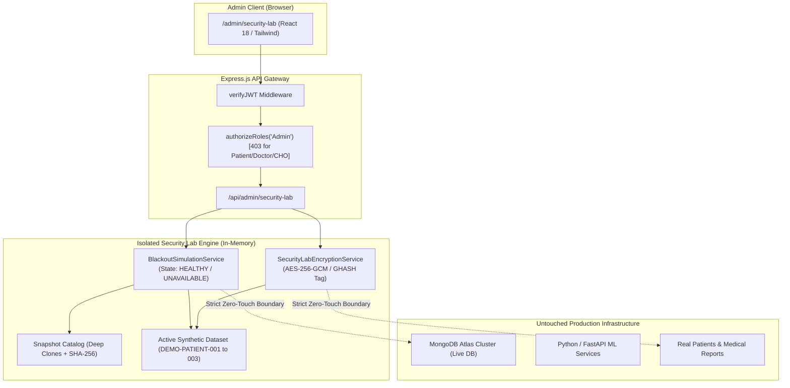

# MedScan-NCD Security & Resilience Demonstration Lab: Architecture Specification

## 1. Executive Summary & Design Principles

The **MedScan-NCD Security & Resilience Demonstration Lab** is an admin-restricted engineering showcase embedded directly within the MedScan-NCD healthcare platform (`/admin/security-lab`). Designed specifically for academic defenses and senior faculty presentations, it implements **strictly two system-design concepts**:

1. **Database Blackout, Snapshot & Recovery Simulation**: A fault injection engine that demonstrates graceful application degradation, sanitized error propagation (HTTP 503), simulated data loss (wiping active synthetic records from 3 → 0), point-in-time snapshot restoration, and deterministic SHA-256 integrity verification.
2. **Medical Data Breach Simulation with Application-Level Encryption**: A cryptographic demonstration illustrating the exposure difference between stored ciphertext and plaintext in the event of a raw database dump using **AES-256-GCM** (Galois/Counter Mode), complete with real-time GHASH tampering rejection.



---

## 2. Non-Negotiable Isolation Boundaries

In high-consequence healthcare SaaS environments, demonstration tools must never risk production availability or clinical data integrity. The Security Lab enforces four core isolation boundaries:

1. **Live Database Isolation**:
   - The production Mongoose connection to MongoDB Atlas is never severed, shut down, mutated, or paused.
   - Live application health endpoints (`/health` and `/api/health`) continue to report genuine database and ML telemetry in parallel (`readyState: 1`).
2. **Synthetic Data Quarantine**:
   - All operations are confined to fixed, clearly marked demonstration identifiers:
     - `DEMO-PATIENT-001` (Aarav Demo, Report: `DEMO-REPORT-001`)
     - `DEMO-PATIENT-002` (Diya Demo, Report: `DEMO-REPORT-002`)
     - `DEMO-PATIENT-003` (Rohan Demo, Report: `DEMO-REPORT-003`)
     - `datasetType`: `SYNTHETIC_DEMO_ONLY`
   - Real patient profiles, medical reports, OCR extractions, and model predictions are completely inaccessible to the simulation engine.
3. **Session & Process Safety**:
   - Simulated blackout and data loss transitions occur strictly inside `blackoutSimulationService`'s memory. Real user requests (Patient, Doctor, CHO) continue hitting live MongoDB Atlas without disruption.
4. **Endpoint Hardening & Parameter Whitelisting**:
   - Request bodies cannot inject arbitrary MongoDB collection names, database names, or disk paths. Any such attempt is rejected immediately with HTTP 400.

---

## 3. Cryptographic Design (AES-256-GCM)

The medical data breach demonstration utilizes Node.js native cryptographic primitives (`node:crypto`):

```
+---------------------------------------------------------------------------------------+
|                                AES-256-GCM Stored Envelope                           |
+---------------------+-------------------+---------------------+-----------------------+
|  Algorithm (String) |  Key Version      |  IV / Nonce (Hex)   | Auth Tag (Hex)        |
|  "aes-256-gcm"      |  "v1"             |  12 Bytes (96-bit)  | 16 Bytes (128-bit)    |
+---------------------+-------------------+---------------------+-----------------------+
|  Ciphertext (Hex)                                                                     |
|  Encrypted JSON payload containing: name, diagnosis, vitals, sampleMedicalField       |
+---------------------------------------------------------------------------------------+
```

### Cryptographic Invariants:
- **Unique Nonce Per Operation**: Every call to `encryptSyntheticRecord()` generates 12 cryptographically random bytes via `crypto.randomBytes(12)`.
- **Integrity & Authenticity**: A 16-byte GHASH tag (`cipher.getAuthTag()`) verifies both ciphertext and metadata.
- **Fail-Safe Decryption**: If any bit of the ciphertext or tag is modified, `decipher.final()` throws an authentication error. No plaintext is ever output.
- **Key Isolation**: The 256-bit demonstration key is held strictly in server memory. The key is never serialized into API responses, client bundles, or database records.

---

## 4. Threat Model & Security Matrix

| Threat Vector | Mitigation Strategy | Demo Verification |
| :--- | :--- | :--- |
| **Data Loss via Corruption / Deletion** | Point-in-time independent snapshot copies with SHA-256 checksums. | Step C wipes active records (3 → 0); Step E restores from snapshot (`INTEGRITY_VERIFIED`). |
| **Snapshot Tampering / Degradation** | Snapshots are deep-cloned immutable objects. Restoring does not mutate the snapshot. | Step F restores from the same snapshot a 2nd time, proving immutability. |
| **Direct Database Dump Exfiltration** | Application-level encryption of sensitive clinical fields. Stored data is pure ciphertext without the server key. | Stage C: Raw database dump displays unreadable ciphertext. |
| **Ciphertext Tampering / Bit-Flipping** | AES-256-GCM authenticated encryption tag (GHASH). | Tamper test flips a bit; server detects mismatch and safely rejects payload. |
| **Database Failure Injection** | In-memory simulated state machine with sanitized 503 response. Writes abort safely. | Blackout step D: synthetic write aborted without dirty state. |
| **Unauthorized Access to Lab** | Strict RBAC (`verifyJWT`, `authorizeRoles('Admin')`). | Automated tests prove Patient, Doctor, CHO get 403; unauthenticated gets 401. |
| **Arbitrary Injection / IDOR** | Strict parameter whitelisting. Rejection of arbitrary collection or path params. | Security boundary test proves collection parameter injection is blocked. |

---

## 5. Directory Structure & Key Files

```
MedScan_NCD/
├── backend/
│   ├── src/
│   │   ├── services/
│   │   │   ├── blackoutSimulationService.js    # Snapshot engine, data loss & recovery state machine
│   │   │   └── securityLabEncryptionService.js  # AES-256-GCM cryptographic engine
│   │   ├── controllers/
│   │   │   └── securityLabController.js        # Controller with sanitized handlers & whitelisting
│   │   ├── routes/
│   │   │   └── securityLabRoutes.js            # RBAC-protected router (/api/admin/security-lab)
│   │   └── server.js                           # Mounted at /api/admin/security-lab
│   └── tests/
│       └── security_lab.test.js                # 22 automated integration tests (100% pass)
├── frontend/
│   ├── src/
│   │   ├── services/
│   │   │   └── securityLabService.js           # Frontend API client
│   │   ├── pages/
│   │   │   └── admin/
│   │   │       └── SecurityLabPage.jsx         # Console UI with steppers, table & diagrams
│   │   ├── routes/
│   │   │   └── AppRoutes.jsx                   # Route: /admin/security-lab (Admin only)
│   │   └── components/
│   │       └── common/
│   │           └── Sidebar.jsx                 # Admin navigation link with ShieldCheck icon
└── docs/
    └── system-design/
        ├── SECURITY_LAB_ARCHITECTURE.md
        ├── DATABASE_BLACKOUT_DEMO.md
        ├── DATA_BREACH_ENCRYPTION_DEMO.md
        ├── FACULTY_PRESENTATION_SCRIPT.md
        └── SECURITY_LAB_TEST_REPORT.md
```
